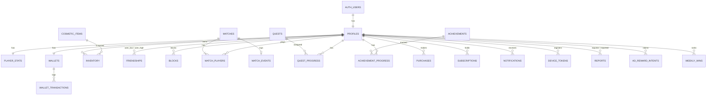

# DATABASE_SCHEMA — Veritabanı Tasarımı (Supabase Postgres)

> **Durum:** Faz 1 taslağı (2026-11-16).
>
> **Bu belgede:** SQL, uygulamaya yakın bir taslaktır. Geçiş (migration) dosyalarına Faz 4'te dönüştürülür; ad ve tipler o aşamada küçük değişiklikler alabilir.
>
> **Faz 2 sonrası güncelleme (2026-11-17):** Bu belgenin farkları [architecture/SUPABASE_ARCHITECTURE.md](architecture/SUPABASE_ARCHITECTURE.md) §4'te: iki para birimi, negatifsiz bakiye, emanet, borç, Redis'in kaldırılması. Ekonomi tabloları için güncel taslak [economy/GOLD_AND_DIAMOND_ECONOMY.md](economy/GOLD_AND_DIAMOND_ECONOMY.md) §4.
>
> **Temel güvenlik ilkesi:** İstemcinin **yazma yetkisi yoktur**. Bütün yazmalar, oyun sunucusunun (Cloudflare) sınırlı yetkili `game_server` rolüyle çağırdığı denetimli sunucu işlevlerinden yapılır (K-59). İstemci RLS ile yalnızca kendi verisini okur (SECURITY_SPECIFICATION §4).

## 1. Genel kurallar

- **Şema:** `public`. Kimlik tabloları Supabase'in `auth` şemasında; bütün kullanıcı tabloları `auth.users(id)`'ye bağlıdır ve hesap silinince kişisel veriler temizlenir (§6).
- **Kimlikler:** `uuid` (`gen_random_uuid()`); katalog öğeleri için okunabilir metin kimlik (`'dice_gold'`).
- **Zaman:** `timestamptz`, UTC. Günlük sıfırlamalar oyuncunun saat dilimine göre değil, **sabit TR saati 00:00 (UTC+3)** ile yapılır (öneri; LOCALIZATION §4).
- **Para:** `bigint` tam sayı (altın), mağaza fiyatı `price_micros bigint` + `currency char(3)`.
- **Sıralı tipler:** Postgres `enum` yerine `text` + `CHECK`. Yeni değer eklemek daha kolay olur.
- **RLS:** **Bütün tablolarda açık.** Varsayılan: `anon` ve `authenticated` rollerinden her yetki geri alınır, gerekenler tek tek verilir.

## 2. Varlık ilişkileri



## 3. Tablolar

### 3.1 Kullanıcı ve profil

```sql
create table profiles (
  user_id        uuid primary key references auth.users(id) on delete cascade,
  display_name   text not null check (char_length(display_name) between 3 and 16),
  name_key       text not null,              -- küçük harf + Türkçe katlama (İ→i, I→ı) + aksan koruma; arama için
  tag            int  not null check (tag between 1 and 99999),
  avatar_id      text not null default 'avatar_01' references cosmetic_items(id),
  frame_id       text references cosmetic_items(id),
  dice_id        text not null default 'dice_classic' references cosmetic_items(id),
  pawn_set_id    text not null default 'pawn_classic' references cosmetic_items(id),
  board_id       text not null default 'board_classic' references cosmetic_items(id),
  level          int  not null default 1 check (level >= 1),
  xp             bigint not null default 0 check (xp >= 0),       -- mevcut seviye içindeki XP
  locale         text not null default 'tr',
  country        char(2),                    -- mağaza ülkesi; reklam/mevzuat için
  account_kind   text not null default 'guest' check (account_kind in ('guest','linked')),
  premium_until  timestamptz,                -- abonelik durumundan türetilir (işçi günceller)
  name_changed_at timestamptz,
  banned_until   timestamptz,                -- null: yasak yok; 'infinity': kalıcı
  deletion_requested_at timestamptz,
  created_at     timestamptz not null default now(),
  updated_at     timestamptz not null default now(),
  unique (name_key, tag)
);
create index profiles_name_key_idx on profiles (name_key);

create table player_stats (
  user_id          uuid primary key references profiles(user_id) on delete cascade,
  matches_2p       int not null default 0,  wins_2p        int not null default 0,
  matches_4p       int not null default 0,  firsts_4p      int not null default 0,
  seconds_4p       int not null default 0,  thirds_4p      int not null default 0,
  abandons         int not null default 0,
  captures         int not null default 0,  captured        int not null default 0,
  pawns_finished   int not null default 0,  sixes_rolled    int not null default 0,
  win_streak       int not null default 0,  best_win_streak int not null default 0,
  play_seconds     bigint not null default 0,
  updated_at       timestamptz not null default now()
);
```

- **Arkadaş kodu:** `display_name + '#' + tag` (ör. `Ayşe#4821`).
- **Arama:** Kod yazıldığında `name_key` + `tag` ile birebir aranır; kısmi ad araması **yoktur** (UI_SCREEN_SPECIFICATIONS §11).
- **Etiket ataması:** API, ad için boş bir etiketi rastgele seçer.

### 3.2 Sosyal

```sql
create table friendships (
  user_low     uuid not null references profiles(user_id) on delete cascade,
  user_high    uuid not null references profiles(user_id) on delete cascade,
  status       text not null check (status in ('pending','accepted')),
  requested_by uuid not null references profiles(user_id) on delete cascade,
  created_at   timestamptz not null default now(),
  accepted_at  timestamptz,
  primary key (user_low, user_high),
  check (user_low < user_high),
  check (requested_by in (user_low, user_high))
);
create index friendships_high_idx on friendships (user_high);
create index friendships_pending_idx on friendships (status, created_at) where status = 'pending';

create table blocks (
  blocker_id uuid not null references profiles(user_id) on delete cascade,
  blocked_id uuid not null references profiles(user_id) on delete cascade,
  created_at timestamptz not null default now(),
  primary key (blocker_id, blocked_id),
  check (blocker_id <> blocked_id)
);
create index blocks_blocked_idx on blocks (blocked_id);
```

- **Tek satır kuralı:** Arkadaşlık **tek satırdır**; çift `(küçük, büyük)` sırasıyla saklanır, böylece çift kayıt oluşamaz.
- **Sınırlar:** 200 arkadaş ve 50 bekleyen istek sınırları API'de denetlenir; tetikleyiciyle (trigger) ikinci bir koruma da eklenir.
- **Geçici veriler:** Özel odalar Cloudflare'deki maç nesnesinde (MatchRoom, bekleme aşaması) tutulur; davetler Supabase Realtime ile iletilir. Davetin kalıcı izi `notifications` satırıdır. (Eski plandaki Redis kaldırıldı.)

### 3.3 Maçlar

```sql
create table matches (
  id          uuid primary key default gen_random_uuid(),
  mode        text not null check (mode in ('2p','4p')),
  kind        text not null check (kind in ('quick','private','bot_fill')),
  ruleset_id  text not null,
  ruleset     jsonb not null,                       -- GAME_RULES §12 (o anki tam set)
  region      text not null,
  status      text not null check (status in ('finished','void')),
  started_at  timestamptz not null,
  ended_at    timestamptz not null,
  duration_s  int generated always as (extract(epoch from (ended_at - started_at))::int) stored,
  server_node text,
  seed_hash   text,                                 -- v1.1 denetlenebilir zar
  created_at  timestamptz not null default now()
);
create index matches_ended_idx on matches (ended_at desc);

create table match_players (
  match_id    uuid not null references matches(id) on delete cascade,
  seat        smallint not null check (seat between 0 and 3),
  user_id     uuid references profiles(user_id) on delete set null,  -- bot ya da silinmiş: null
  is_bot      boolean not null default false,
  color       text not null check (color in ('red','green','yellow','blue')),
  placement   smallint check (placement between 1 and 4),
  result      text not null check (result in ('win','placed','lose','abandoned','void')),
  pawns_finished smallint not null default 0,
  captures    smallint not null default 0,
  timeouts    smallint not null default 0,
  disconnect_s int not null default 0,
  coins_awarded int not null default 0,
  xp_awarded    int not null default 0,
  ended_at    timestamptz not null,                 -- sorgu kolaylığı (matches'tan kopya)
  primary key (match_id, seat)
);
create index match_players_user_idx on match_players (user_id, ended_at desc);

create table match_events (
  match_id   uuid primary key references matches(id) on delete cascade,
  events_gz  bytea not null,                         -- gzip'li JSON olay günlüğü (zar, hamle, zaman aşımı, kopma)
  created_at timestamptz not null default now()
);   -- 90 gün sonra işçi siler
```

- **Pratik maçlar:** Çevrimdışı pratik maçlar sunucuya yazılmaz.
- **Bot doldurmalı maçlar:** `kind='bot_fill'` olarak kaydedilir; ödülleri farklı hesaplanır (ECONOMY §4).

### 3.4 Ekonomi ve envanter

> **Faz 2 ve sonrası güncelleme:** İki para birimi (`gems` sütunu, `wallet_transactions.currency`), **negatifsiz bakiye**, maç girişi emaneti (`match_entries`), iade borcu (`wallet_debts`) ve yeni nedenler [economy/GOLD_AND_DIAMOND_ECONOMY.md](economy/GOLD_AND_DIAMOND_ECONOMY.md) §4'te. Aşağıdaki SQL buna göre düzeltildi.


```sql
create table wallets (
  user_id    uuid primary key references profiles(user_id) on delete cascade,
  coins      bigint not null default 0 check (coins >= 0),   -- Altın; asla negatif değil (iade borcu: wallet_debts)
  gems       bigint not null default 0 check (gems  >= 0),   -- Elmas
  updated_at timestamptz not null default now()
);

create table wallet_transactions (
  id              bigint generated always as identity primary key,
  user_id         uuid not null references profiles(user_id) on delete cascade,
  currency        text not null default 'gold' check (currency in ('gold','gems')),
  delta           bigint not null check (delta <> 0),
  balance_after   bigint not null,
  reason          text not null check (reason in (
                    'match_reward','ad_double','ad_free_coins','daily_login','quest','quest_bonus',
                    'achievement','level_up','store_purchase','iap','starter_pack','premium_daily',
                    'account_link_bonus','refund_clawback','compensation','admin_adjust',
                    'match_entry','match_payout','match_refund','daily_free_gold','bailout',
                    'iap_gold','iap_gems','debt_settlement')),
  ref_type        text,            -- 'match' | 'purchase' | 'quest' | 'ad_intent' | ...
  ref_id          text,
  idempotency_key text not null unique,   -- ör. 'match:<id>:seat:2', 'iap:<transaction_id>'
  created_at      timestamptz not null default now()
);
create index wallet_tx_user_idx on wallet_transactions (user_id, created_at desc);

create table cosmetic_items (
  id            text primary key,                     -- 'dice_gold'
  type          text not null check (type in ('dice','pawn_set','board','frame','avatar','emote')),
  rarity        text not null check (rarity in ('common','rare','epic','legendary')),
  price_coins   int check (price_coins > 0),          -- null: altınla satılmaz (standart kozmetik)
  price_gems    int check (price_gems > 0),           -- null: Elmasla satılmaz (premium kozmetik)
  iap_product_id text,                                -- doğrudan IAP ile satılıyorsa
  premium_only  boolean not null default false,
  source_note   text,                                 -- 'level_10', 'season_1', 'starter_pack'
  asset_key     text not null,
  active        boolean not null default true,
  sort_order    int not null default 0,
  created_at    timestamptz not null default now()
);

create table inventory (
  user_id     uuid not null references profiles(user_id) on delete cascade,
  item_id     text not null references cosmetic_items(id),
  source      text not null check (source in ('default','store','iap','reward','premium','starter','compensation')),
  source_ref  text,
  acquired_at timestamptz not null default now(),
  revoked_at  timestamptz,                             -- iade ile geri alınırsa
  primary key (user_id, item_id)
);
```

- **Bakiye kuralı:** `wallets.coins`, `wallet_transactions` toplamıyla **her zaman** tutarlıdır. İkisi aynı işlemde yazılır.
  - Gece çalışan bir doğrulama işi rastgele 1.000 cüzdanı denetler ve fark varsa uyarı verir.
- **Kuşanma:** Kuşanılan öğe (`profiles.dice_id` …) API'de envanter kontrolüyle değişir. Premium öğe üyelik bitince kuşanılmış kalabilir mi? Öneri: hayır, varsayılana döner (MONETIZATION §4).

### 3.5 Görevler, başarımlar, giriş ödülü, sıralama

```sql
create table quests (
  id            text primary key,               -- 'daily_play_3'
  period        text not null check (period in ('daily','weekly')),
  kind          text not null check (kind in ('play_matches','win_matches','capture_pawns','finish_pawns',
                                              'roll_sixes','play_with_friend','place_top2_4p','use_emote')),
  target        int not null check (target > 0),
  reward_coins  int not null default 0,
  reward_xp     int not null default 0,
  weight        int not null default 10,        -- rastgele seçim ağırlığı
  active        boolean not null default true
);

create table quest_progress (
  user_id      uuid not null references profiles(user_id) on delete cascade,
  period_start date not null,                   -- TR günü (ya da haftası)
  slot         smallint not null check (slot between 0 and 4),
  quest_id     text not null references quests(id),
  progress     int not null default 0,
  completed_at timestamptz,
  claimed_at   timestamptz,
  rerolled     boolean not null default false,
  primary key (user_id, period_start, slot)
);

create table achievements (
  id           text primary key,                -- 'captures_100'
  category     text not null check (category in ('match','social','collection','mastery')),
  stat_key     text not null,                   -- player_stats sütunu ya da özel sayaç
  target       int not null,
  reward_coins int not null default 0,
  reward_item_id text references cosmetic_items(id),
  hidden       boolean not null default false,
  sort_order   int not null default 0
);

create table achievement_progress (
  user_id        uuid not null references profiles(user_id) on delete cascade,
  achievement_id text not null references achievements(id),
  progress       int not null default 0,
  unlocked_at    timestamptz,
  claimed_at     timestamptz,
  primary key (user_id, achievement_id)
);

create table daily_login (
  user_id         uuid primary key references profiles(user_id) on delete cascade,
  cycle_day       smallint not null default 0 check (cycle_day between 0 and 7),
  last_claim_date date
);

create table weekly_wins (
  week_start date not null,
  user_id    uuid not null references profiles(user_id) on delete cascade,
  wins       int not null default 0,
  updated_at timestamptz not null default now(),
  primary key (week_start, user_id)
);
create index weekly_wins_rank_idx on weekly_wins (week_start, wins desc, updated_at);
```

- **Canlı sıralama:** `weekly_wins` tablosu ve `weekly_wins_rank_idx` indeksiyle Postgres'ten okunur; sıralama ekranı kısa süreli önbellekle sunulur. (Eski plandaki Redis sıralı kümesi kaldırıldı; ölçekte gerekirse yeniden değerlendirilir.)
  - Eşitlikte önce o sayıya ulaşan üstte (`updated_at`).
- **Sezonlar** (v1.1): `seasons`, `season_ratings`, `season_rewards` tabloları Faz 11'de tanımlanır.

### 3.6 Satın almalar, abonelikler, reklam ödülleri

```sql
create table purchases (
  id             uuid primary key default gen_random_uuid(),
  user_id        uuid references profiles(user_id) on delete set null,
  platform       text not null check (platform in ('google','apple')),
  environment    text not null check (environment in ('production','sandbox')),
  product_id     text not null,
  transaction_id text not null,           -- Google: orderId; Apple: transactionId
  purchase_token text,                    -- Google
  original_transaction_id text,           -- Apple
  status         text not null check (status in ('pending','granted','refunded','revoked','failed')),
  quantity       int not null default 1,
  price_micros   bigint,
  currency       char(3),
  verified_payload jsonb not null,        -- platformun doğrulanmış yanıtından gerekli alanlar
  granted_at     timestamptz,
  refunded_at    timestamptz,
  created_at     timestamptz not null default now(),
  unique (platform, transaction_id)
);
create index purchases_user_idx on purchases (user_id, created_at desc);

create table subscriptions (
  platform        text not null check (platform in ('google','apple')),
  original_id     text not null,          -- Google: ilk purchaseToken (linkedPurchaseToken zinciri); Apple: originalTransactionId
  user_id         uuid references profiles(user_id) on delete set null,
  product_id      text not null,
  status          text not null check (status in ('active','grace','on_hold','paused','canceled','expired','revoked')),
  current_period_end timestamptz not null,
  auto_renew      boolean not null,
  in_trial        boolean not null default false,
  environment     text not null,
  updated_at      timestamptz not null default now(),
  primary key (platform, original_id)
);
create index subscriptions_user_idx on subscriptions (user_id);

create table ad_reward_intents (
  id          uuid primary key default gen_random_uuid(),
  user_id     uuid not null references profiles(user_id) on delete cascade,
  placement   text not null check (placement in ('double_match_reward','free_coins','quest_reroll')),
  ref_id      text,                       -- maç kimliği vb.
  reward      jsonb not null,             -- {"coins": 80}
  status      text not null check (status in ('created','granted','expired')),
  ssv_transaction_id text unique,         -- AdMob SSV transaction_id
  created_at  timestamptz not null default now(),
  granted_at  timestamptz
);
create index ad_intents_user_day_idx on ad_reward_intents (user_id, created_at desc);
```

- **Tek seferlik ödül:** `unique (platform, transaction_id)` ve `wallet_transactions.idempotency_key = 'iap:'||transaction_id` aynı satın almanın iki kez ödüllendirilmesini **iki katmanda** engeller.

### 3.7 Bildirimler, cihazlar, şikâyetler, yönetim

```sql
create table notifications (
  id         uuid primary key default gen_random_uuid(),
  user_id    uuid not null references profiles(user_id) on delete cascade,
  type       text not null check (type in ('friend_request','friend_accepted','invite','reward_ready',
                                           'compensation','system','report_result')),
  payload    jsonb not null,               -- metin anahtarı + parametreler (LOCALIZATION §7)
  read_at    timestamptz,
  created_at timestamptz not null default now(),
  expires_at timestamptz not null default now() + interval '30 days'
);
create index notifications_user_idx on notifications (user_id, created_at desc);

create table device_tokens (
  token      text primary key,
  user_id    uuid not null references profiles(user_id) on delete cascade,
  platform   text not null check (platform in ('android','ios')),
  locale     text not null,
  created_at timestamptz not null default now(),
  last_seen  timestamptz not null default now()
);

create table reports (
  id          uuid primary key default gen_random_uuid(),
  reporter_id uuid references profiles(user_id) on delete set null,
  reported_id uuid references profiles(user_id) on delete set null,
  reason      text not null check (reason in ('offensive_name','offensive_profile','griefing','cheating','other')),
  details     text check (char_length(details) <= 500),
  match_id    uuid references matches(id) on delete set null,
  status      text not null default 'open' check (status in ('open','reviewing','actioned','dismissed')),
  action      text,
  handled_by  uuid,
  handled_at  timestamptz,
  created_at  timestamptz not null default now()
);
create index reports_reported_idx on reports (reported_id, created_at desc);
create index reports_open_idx on reports (status, created_at) where status in ('open','reviewing');

create table moderation_actions (
  id         bigint generated always as identity primary key,
  user_id    uuid not null references profiles(user_id) on delete cascade,
  action     text not null check (action in ('warn','force_rename','mute_emotes','ban_temp','ban_perm','unban')),
  reason     text not null,
  until      timestamptz,
  created_by uuid not null,
  created_at timestamptz not null default now()
);

create table app_config (
  key        text primary key,          -- 'min_version_android', 'maintenance', 'ad_policy', 'feature_flags'
  value      jsonb not null,
  updated_at timestamptz not null default now()
);
```

## 4. RLS politikaları

**Varsayılan:**

```sql
alter table <her_tablo> enable row level security;
revoke all on <her_tablo> from anon, authenticated;
```

Service role / gizli API anahtarı RLS'i atlar. Kullanılırsa **yalnızca** Cloudflare'de gizli anahtar olarak durur; tercihen hiç kullanılmaz. Oyun sunucusu yalnızca sunucu işlevlerinde `EXECUTE` yetkisi olan `game_server` rolüyle bağlanır (K-59; architecture/SUPABASE_ARCHITECTURE §5).

| Tablo | `authenticated` için izin | Politika |
|---|---|---|
| `profiles` | `select` (kendi satırı) | `using (user_id = auth.uid())` |
| Başkalarının profili | Doğrudan erişim yok | RPC `get_profile_cards(ids uuid[])`: `security definer`, `search_path=public`; yalnızca güvenli sütunlar (ad, etiket, avatar, çerçeve, seviye, premium mi). Çağıranı engellemiş ya da çağıran tarafından engellenmiş kullanıcıları döndürmez. |
| `player_stats` | `select` kendi | `user_id = auth.uid()`. Başkasının istatistiği `get_profile_stats(id)` RPC'siyle, engelleme kontrollü. |
| `wallets`, `wallet_transactions`, `inventory` | `select` kendi | `user_id = auth.uid()`. **Yazma yok.** |
| `friendships` | `select` | `auth.uid() in (user_low, user_high)`. Yazma API'de (sınır + engelleme kontrolü). |
| `blocks` | `select` kendi verdikleri | `blocker_id = auth.uid()`. Kimin kendisini engellediği **görünmez**. |
| `matches`, `match_players` | `select` | Yalnızca katıldığı maçlar: `exists (select 1 from match_players mp where mp.match_id = id and mp.user_id = auth.uid())` |
| `match_events` | Yok | Yalnızca destek ve sunucu |
| `cosmetic_items`, `quests`, `achievements` | `select` (anon dahil) | `active = true` (katalog herkese açık) |
| `quest_progress`, `achievement_progress`, `daily_login` | `select` kendi | `user_id = auth.uid()` |
| `weekly_wins` | Doğrudan yok | RPC `get_leaderboard(week, scope, offset)`: ad ve avatarla birlikte; engellenenler gizlenir |
| `purchases`, `subscriptions` | `select` kendi | Yalnızca `product_id`, `status`, tarihler (sütun yetkisi ile `verified_payload` hariç) |
| `ad_reward_intents` | `select` kendi | Durum sorgusu için |
| `notifications` | `select` kendi | `user_id = auth.uid()`; okundu işareti RPC `mark_notifications_read(ids)` ile |
| `device_tokens`, `reports`, `moderation_actions` | Yok | Yalnızca API |
| `app_config` | `select` (anon dahil) | Yalnızca `key in ('min_version_android','min_version_ios','maintenance','feature_flags')` |

**RPC kuralları:**
- Bütün `security definer` işlevler `set search_path = public, pg_temp` ile tanımlanır.
- Girdiler doğrulanır (dizi uzunluğu ≤ 100).
- Okuma amaçlı RPC'lerde `execute` yetkisi yalnızca `authenticated` rolüne verilir.
- **Yazan işlevler** (ekonomi, maç, satın alma) `anon` ve `authenticated` rollerine **kapalıdır**; yalnızca `game_server` çağırabilir.

**RLS testleri (Faz 4 kabul ölçütü):** Her tablo için iki test kullanıcısıyla "kendi verisini görür, başkasınınkini göremez, yazamaz" senaryoları otomatik çalıştırılır.

## 5. Önemli işlemler (sunucu tarafı, tek işlem)

> **Güncel liste:** architecture/SUPABASE_ARCHITECTURE §5: `escrow_match_entry`, `settle_match`, `refund_match`, `grant_purchase`, `revoke_purchase`, `claim_reward`, `buy_item`.
> - `grant_match_rewards` artık `settle_match`'in parçasıdır.
> - `buy_cosmetic` artık `buy_item`'dır; Altın ya da Elmasla çalışır.
> - `grant_iap` artık `grant_purchase`'tır.
>
> Aşağıdaki maddeler o işlevlerin içeriğini anlatır.

1. **`grant_match_rewards(match_id)`:**
   - `matches` ve `match_players` ekler.
   - Her oyuncu için `wallet_transactions` (anahtar `match:<id>:seat:<n>`) + cüzdan güncellemesi.
   - XP ve seviye atlama ödülleri.
   - `player_stats`, `quest_progress`, `achievement_progress` ve `weekly_wins` güncellenir.
2. **`buy_cosmetic(user, item)`:**
   - `select ... for update` ile cüzdan kilitlenir.
   - Fiyat kontrolü, envanter ekleme (zaten varsa hata), işlem kaydı.
3. **`grant_iap(purchase)`:** `purchases` ekleme (benzersizlik) + ürün tanımına göre altın ya da öğe + işlem kaydı.
4. **`claim_quest(user, period, slot)`:** `claimed_at is null and completed_at is not null` kontrolü + ödül.

## 6. Saklama ve silme

| Veri | Saklama |
|---|---|
| `match_events` | 90 gün |
| `notifications` | 30 gün |
| `ad_reward_intents` | 90 gün |
| `wallet_transactions` | 2 yıl (sonra özetlenir) |
| `purchases` | Yasal süre boyunca (vergi / tüketici; K-48 notu); kullanıcı silinince `user_id = null` |

**Hesap silme (gün 30):**
- `profiles` satırı silinir (cascade: istatistik, cüzdan, envanter, arkadaşlık, bildirim, cihaz).
- `match_players.user_id` ve `reports` alanları `null` olur; geçmiş maçlarda "Silinmiş oyuncu" görünür.
- Son olarak `auth.users` kaydı silinir.
