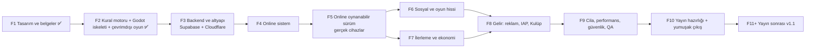

# DEVELOPMENT_ROADMAP — Geliştirme Fazları

> **Durum:** Faz 1 taslağı (2026-11-16). **Faz 2 sonrası güncelleme (2026-11-17):**
> - F1 ve F2 tamamlandı.
> - F3–F5 yeni çevrimiçi mimariye göre yeniden tanımlandı: F3 backend ve altyapı, F4 online sistem, F5 online oynanabilir sürüm.
> - F6 ve sonrası taslak.
>
> **Sıra** (senin istediğin): oynanabilir temel oyun → hesap ve çevrimiçi altyapı → sosyal → ilerleme ve gelir → optimizasyon ve yayın.
>
> **İlke:** Her faz bir öncekinin üstüne inşa edilir. Büyük yeniden yazım yoktur. Her faz bir rapor (`PHASE_N_REPORT.md`) ve ölçülmüş sonuçlarla kapanır.

## 1. Genel görünüm

**Göreli büyüklük** (S ≈ 1–2 hafta, M ≈ 2–4 hafta, L ≈ 4–6 hafta; ekip büyüklüğüne bağlıdır, **söz değildir**):

| Faz | F3 | F4 | F5 | F6 | F7 | F8 | F9 | F10 |
|---|---|---|---|---|---|---|---|---|
| Büyüklük | M | L | M | M | M | L | M | M |

## 2. Genel kurallar

- **Fazın başında:** Ön koşul kararları (DECISIONS) netleşir; sonradan değişirse etkisi raporlanır.
- **Her fazda:**
  - Testler yeşil kalır; kural vektörleri %100.
  - Dikey ekran kuralı ve tasarım sistemi korunur.
  - Gerçek para ve gerçek kullanıcı verisiyle test yapılmaz.
- **Fazın sonunda:**
  - Cihaz testi (F3'ten itibaren) ve rapor.
  - Debug APK paylaşımı (önceki projelerdeki gibi bir özel GitHub release'i; K-37 ile birlikte karar verilir).

## 3. Fazlar

### F1 — Tasarım ve dokümantasyon ✅ (2026-11-16)

- **Amaç:** Ürün, kurallar, arayüz, mimari, ekonomi ve gelir modeli geliştirmeden önce eksiksiz tanımlansın.
- **Çıktılar:**
  - 16 belge.
  - Tahta geometrisi (`board_map.json`).
  - 10 ekran prototipi (`docs/design/screens/`).
- **Tamamlanma:** Karar bekleyen konular senin onayına sunuldu (DECISIONS_AND_OPEN_QUESTIONS).

### F2 — Teknik temel ve kural motoru ✅ (2026-11-17)

> **Gerçekleşen:** PHASE_2_REPORT.md.
> - TS motoru (73 test), GDScript motoru (27 test), eşitlik %100.
> - Godot iskeleti ve çevrimdışı oynanabilir pratik; debug APK.
>
> **Yapılmayanlar:**
> - Aşağıdaki 6. madde (eklenti denemeleri) ve 7. madde (Supabase doğrulaması) **yapılmadı**; F3 ve F8'e taşındı.
> - Cihaz testi yapılmadı (telefon bağlı değildi).

- **Amaç:** Riskli teknik varsayımları erkenden doğrulamak ve oyunun kalbi olan kural motorunu kanıtlanmış hâle getirmek.
- **İşler:**
  1. **Ön koşul kararları:** K-07…K-25 (kurallar), K-36 (sunucu), K-41 (görsel yön), K-50 (Godot sürümü).
  2. **Depo yapısı** (TECHNICAL_ARCHITECTURE §15): CI, lint, gizli anahtar taraması.
  3. **`@kb/rules` (TypeScript):** Kural seti şeması, `legalMoves`, `apply`, `botMove`. Birim, özellik tabanlı ve vektör testleri.
  4. **GDScript kural motoru** (aynı vektörlerle eşitlik).
  5. **Godot projesi iskeleti:**
     - yalnızca dikey yön, ölçekleme ayarları, güvenli alan servisi;
     - Compatibility renderer'ın denenmesi;
     - tema tokenları (UiTokens / UiPalette).
  6. **Eklenti denemeleri ("merhaba dünya", gerçek cihazda):** Google Play Billing, StoreKit, AdMob + UMP, Google girişi, Apple girişi, FCM, güvenli depolama, derin bağlantı. Her biri için sürüm uyumu ve bakım durumu raporlanır.
  7. **Supabase:** Yerel yığın (CLI); ilk migration (yalnızca profil); anonim giriş ile kimlik bağlamanın **doğrulanması** (TECHNICAL_ARCHITECTURE §4).
- **Çıktılar:**
  - Kural motoru paketi.
  - İki motorun eşit olduğunu gösteren CI.
  - Godot iskeleti.
  - Eklenti uyumluluk raporu.
  - `PHASE_2_REPORT.md`.
- **Bağımlılıklar:** F1 onayları.
- **Test ölçütleri:**
  - ≥ 150 kural testi, 10.000 maçlık değişmez testi.
  - TS ve GDScript vektörleri %100.
  - Her eklenti gerçek cihazda en az bir kez çalıştı (ya da alternatifi belirlendi).
- **Tamamlanma:** Kurallar kilitlendi (değişiklik vektörle gelir); eklenti riskleri bilinir hâlde.
- **Riskler:**
  - Bir eklentinin Godot sürümüyle uyumsuz olması: özel ince eklenti gerekir, F8 / F4 süresi uzar.
  - Anonim hesaba kimlik bağlamanın beklendiği gibi çalışmaması: OAuth / web akışı.

### F3 — Backend ve altyapı (2026-11-17 güncellemesi)

- **Amaç:** Online oyunun altyapısını ücretsiz planlarla, güvenli ve test edilebilir biçimde kurmak. Oyun motorunu Cloudflare'de çalışır hale getirmek.
- **Ön koşul (senin işlemlerin):**
  - Supabase ve Cloudflare hesapları;
  - alan adı kararı;
  - K-59 ve K-56 kararları.
  - Liste: PHASE_2_POST_UPDATE_REPORT.md §11.
- **İşler:**
  1. **Kural değişikliği (K-13):**
     - Üçüncü atış 1–5. TS motoru, GDScript motoru ve istemcinin yerel zarı.
     - Kural seti alanı `third_six_action: "exclude_six"`.
     - Yeni testler; vektörler yeniden üretilir; eşitlik %100.
  2. **Motorun Cloudflare uyumu** (CLOUDFLARE_ARCHITECTURE §5):
     - Web Crypto zar kaynağı (1–6 / 1–5);
     - tahta verisinin `shared/` kopyası;
     - workerd içinde test (`@cloudflare/vitest-pool-workers`);
     - Node testleri korunur.
  3. **Supabase projesi** (`dev`):
     - Auth yapılandırması: anonim giriş, e-posta, manual linking, asimetrik JWT anahtarları. Google ve Apple sağlayıcıları, istemci kimlikleri hazır olunca.
  4. **PostgreSQL tabloları ve RLS** (migration'lar):
     - profiller, istatistikler, envanter;
     - cüzdan (Altın + Elmas), defter, emanet, borç, satın almalar;
     - arkadaşlık ve istekleri, engellemeler, bildirimler;
     - maç geçmişi, haftalık sıralama.
     - RLS politikaları ve otomatik RLS testleri.
  5. **Sunucu işlevleri ve en az yetkili rol:**
     - `escrow_match_entry`, `settle_match`, `refund_match`, `grant_purchase`, `revoke_purchase`, `claim_reward`, `buy_item`.
     - Hepsi tek işlem ve idempotent. `game_server` rolü. Testler **yalnızca test bakiyesiyle**.
  6. **Cloudflare projesi:**
     - `server/worker`, `wrangler.jsonc`;
     - ortamlar (`local` / `dev`);
     - gizli anahtar yönetimi;
     - DO sınıflarının (Matchmaker, MatchRoom) iskeleti; motoru DO içinde çalıştıran ilk test.
  7. **Teknik denemeler (spike):**
     - T-1: alarm ve hibernation, faturalanan süre;
     - T-2: JWT doğrulama yeri ve CPU;
     - T-7: Hyperdrive + `game_server` rolüyle Supabase'e bağlanma;
     - T-6: zamanlanmış işler.
  8. **Kimlik doğrulama ve yetkilendirme:**
     - Godot'ta ince Supabase istemcisi: misafir girişi, belirteç yenileme, güvenli saklama;
     - Worker'da JWT doğrulama; istemci → Worker → DO "merhaba" bağlantısı.
  9. **Geliştirme ve test ortamları:**
     - yerel yığın (Supabase CLI + `wrangler dev`);
     - CI (motor + vektörler + workerd + RLS);
     - gizli anahtar taraması.
- **Çıktılar:**
  - çalışan `dev` altyapısı (ücretsiz planlar);
  - migration'lar ve RLS testleri;
  - Worker / DO iskeleti;
  - ölçüm notları (T-1, T-2, T-7);
  - `PHASE_3_REPORT.md`.
- **Test ölçütleri:**
  - motor testleri Node'da ve workerd'de yeşil;
  - vektörler %100;
  - üçüncü atış dağılım testi;
  - RLS testleri %100;
  - sunucu işlevlerinde çift çağrı → tek etki;
  - misafir girişiyle alınan JWT, Worker'da doğrulanıyor;
  - istemcide hiçbir gizli anahtar yok (derleme taraması).
- **Riskler:** T-1 sonucu maliyet modelini değiştirebilir; Hyperdrive ile Supabase bağlantısında beklenmeyen kısıtlar (B seçeneği yedek).

### F4 — Online sistem

- **Amaç:** Sunucu otoriteli, 2 ve 4 kişilik, eşleştirmeli ve özel odalı çevrimiçi maç sisteminin uçtan uca çalışması.
- **İşler:**
  - **WebSocket protokolü** (NETWORK_PROTOCOL): `hello`, kimlik, bilet, istek kimliği, olaylar, hata kodları, sürüm kontrolü; protokol şemaları.
  - **Oyuncu eşleştirme** (Matchmaker DO): mod ve seviye kuyrukları, iptal, bot önerisi (K-05), ceza kontrolleri.
  - **Özel odalar:** kodla kurma ve katılma, bekleme aşaması, hazır olma, bot doldurma, rövanş.
  - **2 ve 4 oyunculu maçlar** (MatchRoom DO).
  - **Renk seçimi** (K-08): özel oda ve hızlı maç tercihleri; çakışma reddi; K-55 ve K-57 kararları.
  - **Arkadaş davetleri:** Supabase Realtime + `notifications`; temel arkadaş listesi ve çevrimiçi durumu (K-64).
  - **Sunucu otoriteli zar ve hamle yönetimi:** üçüncü atış kuralı; süreler (alarm); otopilot; zafer talebi.
  - **Bağlantı kopması ve yeniden bağlanma:** eksik olaylar ya da tam durum; tek oturum.
  - **Maç kurtarma:** DO yeniden başlatma, outbox, `void` ve iade akışı.
  - **Altın giriş ve ödül altyapısı:** emanet → sonuç → iade. **Yalnızca test bakiyesiyle**; altınlı mod özellik bayrağıyla kapalı (E-7).
  - **İstemci:**
    - `Net` autoload, olay kuyruğu;
    - eşleştirme, oda, renk seçimi ve bağlantı durumu ekranları;
    - sonuç ekranı.
    - Faz 2'deki maç ekranı olay biçimiyle kullanılır.
- **Çıktılar:** Çevrimiçi oynanabilir debug APK (`dev` / `staging`), protokol belgesi güncel, `PHASE_4_REPORT.md`.
- **Test ölçütleri:**
  - simüle istemcilerle tam maçlar (2 ve 4 kişilik);
  - idempotency;
  - yarış koşulları (renk, katılma, zaman aşımı);
  - kopma ve yeniden bağlanma;
  - DO yeniden başlatma;
  - emanet ve sonuçta çift çağrı → tek etki.
- **Riskler:**
  - Supabase Realtime'ın GDScript'te uygulanması;
  - mobil ağda WebSocket'in arka planda kapanması.

### F5 — Online oynanabilir sürüm

- **Amaç:** Farklı cihazlardaki gerçek oyuncuların internet üzerinden **sorunsuz** maç yapabilmesi.
- **İşler ve testler:**
  - **Gerçek cihazlar:** Online maçlar (en az 2 Android cihaz; iOS hazırlığı).
  - **Uçtan uca testler:** Giriş → eşleşme → maç → sonuç → kayıt.
  - **Maç testleri:** 2 ve 4 oyunculu; kopma ve geri dönüş dahil.
  - **Hile ve güvenlik testleri** (SECURITY_ARCHITECTURE §10): protokol bulanıklaştırma, başka koltuğun eylemi, zar alanı enjeksiyonu, hız sınırları, RLS.
  - **Altın muhasebe testleri:** Eşzamanlı emanet, çift sonuç, kesinti, mutabakat, bakiye = defter.
  - **Performans ve yük testleri:** Simüle istemcilerle çok sayıda eşzamanlı maç.
  - **WebSocket gecikmesi:** TR'den, mobil ağda ve Wi-Fi'da (K-62).
  - **Ücretsiz kota testleri:** Cloudflare ve Supabase kullanımının ölçülmesi, COST_AND_SCALING tahminleriyle karşılaştırma, K-58 / K-60 kararları.
  - **Android performansı:** Gerçek cihazda (FPS, bellek, pil, ısınma).
  - **iOS uyumluluk hazırlığı:** Mac ve Apple hesabı gelince derleme; olmazsa engeller raporlanır.
- **Çıktılar:**
  - online test sürümü;
  - yük, gecikme ve kota raporu;
  - güncellenmiş maliyet modeli;
  - `PHASE_5_REPORT.md`.
- **Tamamlanma:**
  - farklı ağlardaki cihazlar arasında 50+ kesintisiz test maçı;
  - kopmalarda maç kaybı yok;
  - zar dağılımı testi temiz (üçüncü atış dahil);
  - muhasebe tutarlı.
- **Riskler:**
  - tek telefonla sınırlı cihaz testi (R7);
  - ücretsiz kotaların test sırasında bitmesi (test planı kotaya göre yapılır).

### F6 ve sonrası (taslak; F5 sonunda yeniden değerlendirilecek)

> Eski F3 (çevrimdışı çekirdek cilası), F4 (hesaplar) ve F5 (çevrimiçi maç) içerikleri yeni F3–F5'e dağıtıldı. Aşağıdaki fazlar **sırası ve kapsamı taslak** olarak korunuyor.

| Faz | Kapsam |
|---|---|
| **F6 — Sosyal ve oyun hissi** | Arkadaş sisteminin tamamı, engelleme ve şikâyet, push, derin bağlantılar; ana menü ve ayarlar, eğitim maçı; ses ve titreşim (K-43); hızlı mesajlar |
| **F7 — İlerleme ve ekonomi** | XP / seviye, günlük giriş, görevler, başarımlar; kozmetik katalog ve mağaza (Altın ve Elmas fiyatlı); haftalık sıralama; ekonomi simülasyonu |
| **F8 — Gelir** | Google Play Billing ve StoreKit entegrasyonu (sandbox): sunucu doğrulaması, iade ve iptal, geri yükleme; reklam (AdMob + UMP + SSV); Kulüp aboneliği |
| **F9 — Cila, performans, güvenlik ve QA** | Cihaz matrisi, uzun oturum, güvenlik gözden geçirmesi, erişilebilirlik, yerelleştirme kalite kontrolü |
| **F10 — Yayın hazırlığı ve yumuşak çıkış** | Mağaza sayfaları, hukuki metinler, **altınlı maçlar için hukuki görüş ve mağaza politikası kontrolü** (RISK_GOLD_ENTRY_MATCHES §6), ücretli planlara geçiş (K-58, K-38), kapalı beta, Türkiye'de yumuşak çıkış |

Eski F6–F10'un ayrıntılı iş listeleri, test ölçütleri ve riskleri bu belgenin 2026-11-16 sürümündeydi. Fazlar başlarken güncellenerek yeniden yazılacak.

## 4. MVP tanımı (v1.0)

Kapsam ayrıntısı: GAME_DESIGN_DOCUMENT §7. Özet:
- 2 ve 4 kişilik hızlı maç, özel oda, pratik.
- Dört giriş yöntemi.
- Arkadaşlar, davetler, engelleme ve şikâyet.
- XP, günlük giriş, günlük görevler, başarımlar.
- Altın ve kozmetik mağazası; haftalık sıralama.
- Ödüllü ve geçiş reklamları; IAP; Kulüp.
- TR / EN.

## 5. MVP sonrası genişleme

| Sürüm | Öneri içerik |
|---|---|
| v1.1 | Dereceli mod + kupa puanı + 6 haftalık sezon ve sezon şeridi; haftalık görevler; reklam mediation; denetlenebilir zar (commit–reveal); Play Integrity / App Attest; "Büyük yazı" ayarı |
| v1.2 | Etkinlik sistemi (hafta sonu çift XP, bayram temaları, hızlı mod haftası); yeni kural setleri (Kızma Birader klasik, hızlı); maç izleme (arkadaş maçı) |
| v1.3 | Takım modu (2'ye 2), kulüpler / gruplar, turnuvalar (yalnızca kozmetik ödüllü) |
| v1.x | Yeni diller: Almanca, Arapça (RTL), Rusça, Portekizce; ikinci sunucu bölgesi; aynı cihazda çok oyuncu |

**Her genişleme öncesinde:** Ekonomi ve politika etkisi değerlendirilir. Pay-to-win yasağı ve "maç kutsaldır" ilkesi değişmez.

## 6. Risk kaydı (proje geneli)

| # | Risk | Olasılık | Etki | Önlem |
|---|---|---|---|---|
| R1 | Godot yerel eklentilerinin (IAP, reklam, giriş, push) uyumsuzluğu | Orta | Yüksek | F2'de cihazda deneme; gerekirse özel ince eklenti (Kotlin / Swift) |
| R2 | Düşük oyuncu yoğunluğunda uzun eşleştirme | Yüksek (ilk aylar) | Yüksek | Etiketli bot önerisi, tek bölge, beceri eşleştirmesi yok, arkadaş odaları |
| R3 | Kumar algısı (mevzuat, mağaza); altın satın alınabilir ve maç girişinde kullanılıyor (2026-11-17) | **Orta–Yüksek** | Yüksek | Nakit ve transfer yok, ücretsiz erişim, ülke anahtarı, hukuki görüş öncesi kapalı; rastgele ücretli içerik yok (RISK_GOLD_ENTRY_MATCHES.md) |
| R4 | Ekonomi dengesizliği (enflasyon ya da cimrilik) | Orta | Orta | Uzaktan yapılandırma, haftalık ekonomi raporu, simülasyon |
| R5 | Hile ve işbirliği (4 kişilik) | Orta | Orta | Otoriter sunucu, eşleştirme kısıtları, gece analizleri |
| R6 | Mağaza reddi (giriş, abonelik, hesap silme, gizlilik) | Orta | Orta | Faz 10 kontrol listesi, kurallara baştan uyum |
| R7 | Tek telefonla sınırlı cihaz testi | Yüksek | Orta | Bulut cihaz çiftliği ya da cihaz temini (K-49 notu) |
| R8 | Görsel üretim (avatar, kozmetik, ses) kaynağı belirsiz | Yüksek | Orta | K-42 / K-43 erken kararı; MVP kataloğu küçük tutuldu |
| R9 | Cloudflare (DO satır yazma, süre) ya da Supabase maliyetinin ölçekte artması; ücretsiz planın yayına yetmemesi | Orta | Orta | Hibernation, yazma stratejisi (K-60), kota uyarıları; COST_AND_SCALING.md; gerekirse Node.js alternatifi |
| R11 | Ücretsiz plan günlük kotasının bitmesiyle maçların yarıda kalması | Yüksek (ücretsiz planda) | Yüksek | Herkese açık testten önce Workers Paid (K-58); kota uyarıları |
| R12 | 4 kişilik maçın uzunluğu (ölçüm: ~1.500 eylem, tahminen ~40 dk) | Orta | Orta | K-25 senin kararın; Faz 5'te gerçek oyuncu süresi ölçülür |
| R10 | "Kızma Birader" adının mağazada ayırt edici olmaması | Orta | Düşük–Orta | K-01: ayırt edici marka adı + alt başlık |
