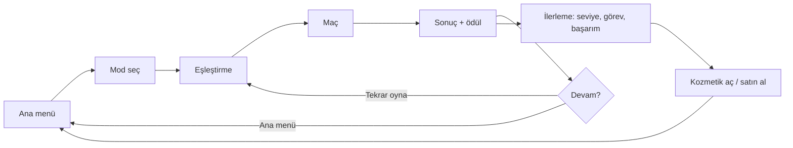

# GAME_DESIGN_DOCUMENT — Oyun Tasarım Dokümanı

> **Durum:** Faz 1 taslağı (2026-11-16).
>
> **Bu belge** ürünün tamamını özetler ve ayrıntılı belgelere bağlanır. Onay bekleyen kararlar **K-xx** ile işaretlidir; ayrıntılar [DECISIONS_AND_OPEN_QUESTIONS.md](DECISIONS_AND_OPEN_QUESTIONS.md) dosyasında.

## 1. Ürün tanımı

- **Ne:** Klasik yıldızlı Kızma Birader / Ludo tahtasında oynanan, çevrimiçi çok oyunculu bir mobil masa oyunu.
- **Çalışma adı:** "Kızma Birader Online" (K-01).
- **Platform:** Android ve iOS; Godot 4; **yalnızca dikey ekran**.
- **İş modeli:** Ücretsiz. Gelir; ödüllü ve geçiş reklamlarından, kozmetik ağırlıklı uygulama içi satın almalardan ve premium üyelikten (Kulüp Üyeliği) gelir.
- **Diller:** İlk sürümde Türkçe ve İngilizce; mimari yeni dillere (sağdan sola yazılanlar dahil) hazır.
- **Hedef kitle:** Masa oyunu seven geniş kitle. Birincil pazar Türkiye; ikincil olarak İngilizce konuşan pazarlar.
  - Önerilen yaş hedefi **13+**; çocuklara yönelik program (Google "Families", Apple Kids) dışında (K-02).
  - Gerekçe: çevrimiçi etkileşim, reklam ve satın alma kuralları çocuk kategorisinde çok kısıtlıdır.

## 2. Tasarım ilkeleri

1. **Tahta kutsaldır.** Klasik yıldızlı tahta, renkleri ve kuralları tanıdık kalır. Yenilik tahtanın etrafındadır: akıcılık, his ve sosyal deneyim.
2. **Hiç beklemeden oyna.** Açılıştan maça en fazla 3 dokunuş. Misafir olarak hemen başlanır; hesap bağlamak sonradan teklif edilir.
3. **Adil ve şeffaf.** Zar sunucuda üretilir. Satın alınan hiçbir şey kazanma şansını değiştirmez (pay-to-win yok). Kurallar maç öncesinde görülür.
4. **Maç kutsaldır.** Maçın içinde reklam yok, satış açılır penceresi yok, dikkat dağıtan bildirim yok.
5. **Sıcak ve canlı his.** Her zar, yeme ve bitiş kısa, tatmin edici bir animasyon ve ses alır; ama oyunu yavaşlatmaz (TESTING §6'daki süre bütçeleri).
6. **Saygılı sosyal yapı.** Serbest yazılı sohbet yok, hazır mesajlar ve emoji var (K-06). Engelleme ve şikâyet her oyuncu kartından iki dokunuşla yapılır.

## 3. Oyun modları

| Mod | MVP | Açıklama |
|---|---|---|
| **Hızlı Maç – 2 Kişi** | ✅ | Otomatik eşleştirme; karşılıklı renkler |
| **Hızlı Maç – 4 Kişi** | ✅ | Otomatik eşleştirme; 4 renk |
| **Özel Oda** | ✅ | Kod ya da davetle 2 / 4 kişilik oda; arkadaşlarla. Ödül kuralları farklı (ECONOMY §4.3). |
| **Pratik** | ✅ öneri (K-04) | Çevrimdışı, botlara karşı; eğitim ve internetsiz oyun. Ödül yok. Ayrıca mağaza incelemesinde tek kişinin oynanışı görebilmesini sağlar. |
| Dereceli (sezonluk) | ❌ v1.1 (K-51) | Kupa puanı + sezon ödülleri |
| Etkinlik modları | ❌ v1.2+ | Hızlı mod, takım (2'ye 2), turnuva |
| Aynı cihazda çok oyuncu | ❌ değerlendirme | Pas-ver-oyna; düşük maliyet, sonra değerlendirilir |

**Eşleşme bulunamazsa** (öneri, K-05):
- 2 kişilikte 25 sn sonra **"Bot ile oyna"** teklif edilir. Bot açıkça "Bot" etiketi taşır, ödül yarıya iner.
- 4 kişilikte 40 sn sonra eksik koltuklar oyuncu onayıyla botla doldurulur.
- Gizli bot (botu insan gibi gösterme) **kullanılmaz**.

## 4. Çekirdek döngü

- **Kısa döngü** (her maç, 8–20 dk): zar → hamle → yeme ya da kaçma → bitiş → sıralama ve ödül.
- **Orta döngü** (günlük): günlük giriş ödülü, 3 günlük görev, ödüllü reklamlar, arkadaşlarla oda.
- **Uzun döngü** (haftalar): seviye, başarımlar, kozmetik koleksiyonu; v1.1'den sonra sezon ve dereceli maç.

## 5. Maç akışı (özet)

1. **Eşleştirme** tamamlanınca maç sahnesine geçilir. Oyuncu kartları ve tahta, en fazla 1 sn'lik bir giriş animasyonuyla yerleşir.
2. **İlk oyuncu** sunucu tarafından seçilir.
3. **Tur:** Sıra kimdeyse onun avatarında sayaç halkası döner. Yerel oyuncunun sırasında zar butonu parlar.
4. **Zar → seçim → hamle:**
   - Zar atılır; sonucu sunucu üretir.
   - Geçerli piyonlar parlar, hedef kareler kesikli halkayla gösterilir.
   - Oyuncu piyona dokunur; piyon kare kare zıplayarak ilerler (kare başına ~90 ms).
5. **Önemli anlar:**
   - **Yeme:** yenen piyon bekleme alanına kayar; ekran hafifçe sarsılır, ses ve titreşim.
   - **Bitiş:** piyon orta üçgene girer, parıltı çıkar; avatardaki bitiş noktalarından biri dolar.
6. **Maç sonu:** sıralama → ödül ekranı → (uygunsa) geçiş reklamı **ana menüye dönerken**.

Kuralların tamamı: [GAME_RULES.md](GAME_RULES.md).

## 6. Sistemler (özet ve kaynak belge)

| Sistem | Özet | Belge |
|---|---|---|
| Hesaplar | Misafir (anonim), Google, Apple, e-posta; misafirin kalıcı hesaba yükseltilmesi; hesap silme | TECHNICAL_ARCHITECTURE §4, SECURITY §2 |
| Profil | Görünen ad + #etiket, avatar, çerçeve, seviye, istatistikler | UI_SCREEN_SPECIFICATIONS §5, DATABASE_SCHEMA |
| Sosyal | Arkadaş kodu, istekler, çevrimiçi durumu, davet, özel oda, engelleme, şikâyet | USER_FLOWS §5–7 |
| Eşleştirme | Moda göre kuyruk, bölge, ileride beceri aralığı; bot önerisi | TECHNICAL_ARCHITECTURE §7 |
| İlerleme | XP / seviye, günlük giriş, günlük görevler, başarımlar | ECONOMY_AND_PROGRESSION |
| Ekonomi | Tek para birimi **Altın** (K-27); kozmetik mağazası | ECONOMY_AND_PROGRESSION |
| Gelir | Ödüllü + geçiş reklamı, IAP, Kulüp Üyeliği | MONETIZATION_DESIGN |
| Bildirimler | Uygulama içi gelen kutusu + push (davet, arkadaş isteği, günlük ödül) | TECHNICAL_ARCHITECTURE §9 |
| Yerelleştirme | TR / EN, anahtar tabanlı, sağdan sola düzen hazırlığı | LOCALIZATION_SPECIFICATION |

## 7. MVP kapsamı (v1.0)

**İçinde:**
- 2 ve 4 kişilik hızlı maç, özel oda, çevrimdışı pratik (bot).
- Misafir, Google, Apple ve e-posta girişi (K-03); misafirden kalıcı hesaba geçiş; hesap silme.
- Profil, avatar (24 hazır avatar), çerçeve, görünen ad + etiket.
- Arkadaş ekleme / silme / istekler, çevrimiçi durumu, maça davet, push bildirimi, engelleme, şikâyet.
- XP / seviye, günlük giriş ödülü (7 günlük döngü), 3 günlük görev, ~20 başarım.
- Altın; kozmetik mağazası: zar, piyon seti, tahta teması, çerçeve, avatar.
- Ödüllü reklam (ödülü 2 katına çıkarma, ücretsiz altın), maç sonrası geçiş reklamı.
- IAP: altın paketleri, **Elmas paketleri** (2026-11-17), başlangıç paketi, kozmetik paketleri; Kulüp Üyeliği (aylık / yıllık).
- Altınlı maç giriş bedeli; hukuki inceleme ve ülke anahtarına bağlı (RISK_GOLD_ENTRY_MATCHES.md).
- TR / EN; ayarlar (ses, müzik, titreşim, dil, bildirimler, tek hamleyi otomatik oyna, renk sembolleri).
- Hazır mesaj + emoji (maç içi).
- Sıralama tablosu: haftalık "en çok galibiyet" listesi. Basit ve sezonsuz (K-26).

**Dışında** (v1.1 ve sonrası; DEVELOPMENT_ROADMAP §5):
- Dereceli maç ve sezonlar, haftalık görevler (K-52), etkinlikler, sezon paketleri.
- Maç izleme, kulüpler, turnuvalar.
- Serbest sohbet (moderasyon gerektirir).
- Yeni diller (Arapça ile sağdan sola düzen dahil).
- Takım modu, aynı cihazda çok oyuncu.

## 8. Başarı ölçütleri (yayın sonrası, hedef; ölçülecek)

| Ölçüt | Hedef (öneri) |
|---|---|
| 1. gün geri dönüş (D1) | ≥ %35 |
| 7. gün geri dönüş (D7) | ≥ %12 |
| Ortalama oturum | ≥ 18 dk |
| Maç tamamlama oranı | ≥ %85 (terk ≤ %8) |
| Eşleştirme süresi, medyan | ≤ 15 sn (2 kişilik), ≤ 30 sn (4 kişilik) |
| Çökmesiz oturum | ≥ %99,5 |
| Ödeme yapan kullanıcı oranı | %1,5–3; reklam ve IAP oranı K-31 / K-34 ile netleşecek |

Bu değerler sektör genel aralıklarıdır; garanti değildir. Yumuşak çıkıştan (soft launch) sonra gerçek verilerle güncellenir.

## 9. Varsayımlar

- **V1:** Sunucu tarafı TypeScript ile yazılır ve Cloudflare Workers + Durable Objects üzerinde çalışır; Supabase kimlik, veri ve sosyal gerçek zamanlılık için kullanılır (K-36, 2026-11-17; architecture/ONLINE_ARCHITECTURE.md).
- **V2:** Yumuşak çıkış Türkiye'de yapılır; Supabase bölgesi Avrupa merkezlidir (öneri Frankfurt). Cloudflare nesneleri oyunculara yakın veri merkezlerinde oluşur (K-37, K-62).
- **V3:** Görsel üretim (avatar, kozmetik, ses) için bütçe ve kaynak henüz belli değil (K-42, K-43).
- **V4:** Oyun adı ve marka tescili kontrolü yapılmadı. "Kızma Birader" bir oyun türünün adı; mağaza adında ayırt edici bir ek gerekebilir (K-01).
