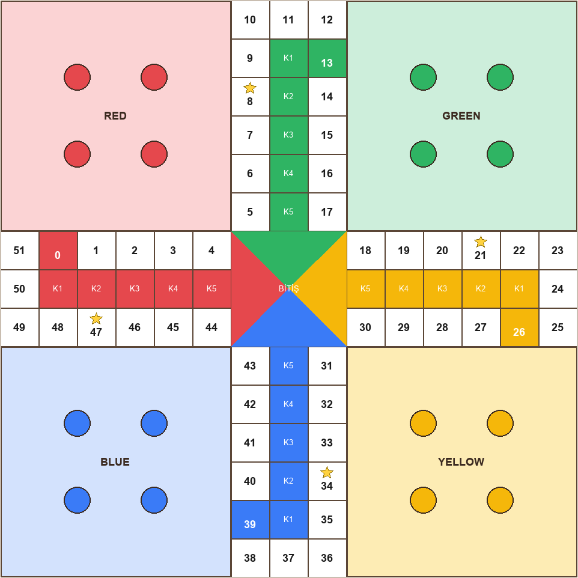

# MAP_SPECIFICATION — Tahta (Harita) Spesifikasyonu

> **Durum:** Faz 1 taslağı (2026-11-16).
>
> **Tek kaynak:** `docs/design/board/board_map.json`. Bu dosyayı `docs/design/_src/board_geometry.py` betiği üretir.
> - Sunucunun kural motoru, Godot istemcisi ve tasarım prototipleri bu dosyayı **olduğu gibi** kullanır; koordinatlar elle yeniden yazılmaz.
> - İndeksli şema: `docs/design/board/board_indices.png`.

## 1. Mantıksal ızgara

- **Izgara:** 15×15 hücre. `x` = sütun (0 = sol), `y` = satır (0 = üst).
- **Bölgeler:**

| Bölge | Hücreler | Açıklama |
|---|---|---|
| Bekleme alanları | 4 × (6×6) | Köşeler: kırmızı (0,0), yeşil (9,0), sarı (9,9), mavi (0,9) |
| Kollar | 4 × (6×3) | Ortak parkur + bitiş koridorları |
| Orta bitiş | 3×3 | (6,6)–(8,8); dört renk üçgeni |

- **Renk düzeni ve sıra yönü:** saat yönünde kırmızı → yeşil → sarı → mavi (öneri, K-07).

## 2. Ortak parkur (52 hücre)

- **Numaralama:** Parkur indeksleri 0–51, saat yönünde. İndeks 0 = kırmızının başlangıç karesi (1,6).
- **Bölümler:**

| Bölüm | Hücreler | İndeks |
|---|---|---|
| Sol kol üst sıra (→) | (1,6)…(5,6) | 0–4 |
| Üst kol sol sütun (↑) | (6,5)…(6,0) | 5–10 |
| Üst kol uç | (7,0) | 11 |
| Üst kol sağ sütun (↓) | (8,0)…(8,5) | 12–17 |
| Sağ kol üst sıra (→) | (9,6)…(14,6) | 18–23 |
| Sağ kol uç | (14,7) | 24 |
| Sağ kol alt sıra (←) | (14,8)…(9,8) | 25–30 |
| Alt kol sağ sütun (↓) | (8,9)…(8,14) | 31–36 |
| Alt kol uç | (7,14) | 37 |
| Alt kol sol sütun (↑) | (6,14)…(6,9) | 38–43 |
| Sol kol alt sıra (←) | (5,8)…(0,8) | 44–49 |
| Sol kol uç | (0,7) | 50 |
| Kırmızı başlangıcından önceki hücre | (0,6) | 51 |

- **Başlangıç kareleri:**

| Renk | Parkur indeksi | Hücre |
|---|---|---|
| Kırmızı | 0 | (1,6) |
| Yeşil | 13 | (8,1) |
| Sarı | 26 | (13,8) |
| Mavi | 39 | (6,13) |

- **Yıldız (güvenli) kareler:** her başlangıcın 8 ilerisi (öneri, K-16).

| Parkur indeksi | Hücre |
|---|---|
| 8 | (6,2) |
| 21 | (12,6) |
| 34 | (8,12) |
| 47 | (2,8) |

- **Güvenli kareler (MVP):** 0, 8, 13, 21, 26, 34, 39, 47.

## 3. Bitiş koridorları ve orta bitiş

- **Koridor:** Her rengin 5 renkli koridor hücresi (K1–K5) ve orta bitiş vardır; bu, **6 adımlık bitiş koridoru** demektir.
  - **Yorum:** Promptta "6 hücrelik bitiş koridoru" diye tanımlanan şeyi "5 hücre + orta bitiş" olarak okudum; 15×15 tahtanın klasik geometrisi buna izin veriyor. Ortadan ayrı 6 renkli hücre, 15×15'te kol boyunu aşar. **Onayına sunuyorum** (DECISIONS: K-07 notu).
- **Koridor hücreleri:**

| Renk | K1 → K5 | Giriş, şu hücreden sonra |
|---|---|---|
| Kırmızı | (1,7) → (5,7) | (0,7), parkur 50 |
| Yeşil | (7,1) → (7,5) | (7,0), parkur 11 |
| Sarı | (13,7) → (9,7) | (14,7), parkur 24 |
| Mavi | (7,13) → (7,9) | (7,14), parkur 37 |

- **Orta bitiş:** Mantıksal olarak tek bir hedef (adım 56). Görsel olarak her rengin kendi üçgenine yerleşir; bitiren piyonlar üçgende küçülerek dizilir.

## 4. Renk başına yol (`paths`)

Her renk için adımlar şöyle tanımlanır:

| Adım | Konum |
|---|---|
| −1 | Bekleme alanı (4 yuva; `yards.<renk>.slots`) |
| 0–50 | Ortak parkur: `track[(start + adım) mod 52]` |
| 51–55 | Koridor K1–K5 |
| 56 | Bitiş (`"GOAL"`) |

- **Uzunluk:** Başlangıçtan bitişe **56 adım** (en az 10 zar).
- **İnceleme sırası:** Sunucu yeme ve güvenli kare kontrolünü **parkur indeksi** üzerinden yapar. İki farklı rengin aynı karede olup olmadığı parkur indeksiyle karşılaştırılır; adım numaraları renk başına farklıdır.

## 5. Bekleme alanı yuvaları

- **Yerleşim:** 6×6 alanın içinde 2×2 düzen. Yerel koordinatlar (1.5, 1.5), (3.5, 1.5), (1.5, 3.5), (3.5, 3.5).
- **Yuva ataması:** Piyon kimlikleri sabittir (`0..3`). Bekleme alanına dönen piyon **kendi** yuvasına döner; böylece animasyon tutarlı olur.

## 6. 2 kişilik düzen

- **Renkler:** Karşılıklı çift: kırmızı–sarı ya da yeşil–mavi. Oyuncular rengini seçer; aynı renk ve karşılıklı olmayan çift sunucuda reddedilir (K-08, kesin; GAME_RULES §2). `board_map.json` içindeki `two_player_colors.default` (kırmızı–sarı) yalnızca çevrimdışı pratikte ve seçim yapılmadığında kullanılır.
- **Kullanılmayan iki renk:** Bekleme alanları soluk gösterilir (opaklık %35), parkurları normal kalır.

## 7. Ekrana yerleşim (görsel katman)

- **Kare kalır:** Tahta her ekranda kare kalır; **esnetilmez ve kırpılmaz**.
- **Boyut:** `board_size = min(safe_width − 2 × 12 pt, kullanılabilir_yükseklik)`. Telefonlarda genişlik belirleyicidir.
  - 360 pt genişlikte tahta 336 pt, hücre 22,4 pt.
  - 320 pt (en küçük) genişlikte tahta 296 pt, hücre 19,7 pt.
- **Döndürme:** Tahta, yerel oyuncunun rengi sol altta olacak biçimde 0/90/180/270° döndürülür (K-09).
  - Yalnızca çizim döner; sembol, yıldız ve piyon görselleri dik kalır.
  - Döndürme matrisi istemcide tek bir yerde uygulanır (`BoardView.rotation_for(color)`).
- **Dokunma:** Hücre 22 pt; 44 pt'lik dokunma hedefinin altında. Bu yüzden:
  - Seçilebilir piyonların dokunma alanı **44×44 pt** daire. Çakışırsa dokunulan noktaya en yakın seçilebilir piyon seçilir.
  - Aynı karede birden çok seçilebilir piyon varsa ve hamleleri farklıysa tahtanın üstünde küçük bir seçim balonu açılır.
  - Seçilemeyen piyonlar dokunmayı engellemez.
- **Katman sırası:** zemin → hücreler → yıldız / ok → son hamle izi → hedef işaretleri → piyonlar → seçim halesi → zar uçuş animasyonu.

## 8. Görsel ayrıntılar (tasarım sistemiyle bağ)

- **Görsel ayrıntılar:** renkler, piyon şekli ve semboller [UI_UX_DESIGN_SYSTEM.md](UI_UX_DESIGN_SYSTEM.md) §7'de.
- **Renk körlüğü desteği:** Her renk ayrıca bir sembolle tanınır (öneri, K-44); semboller bekleme alanı köşesinde, piyon gövdesinde ve oyuncu kartında görünür.

| Renk | Sembol |
|---|---|
| Kırmızı | ▲ üçgen |
| Yeşil | ● daire |
| Sarı | ■ kare |
| Mavi | ◆ elmas |

- **Kozmetik temalar:** Tahta temaları **yalnızca görünümü** değiştirir (doku, renk tonu, çerçeve). Geometri, yıldız yerleri ve okunabilirlik kuralları sabittir.
  - Piyon renkleri temaya göre değişmez; tema yalnızca tonu ±%8 aralığında ayarlayabilir (UI_UX_DESIGN_SYSTEM §7.4).
