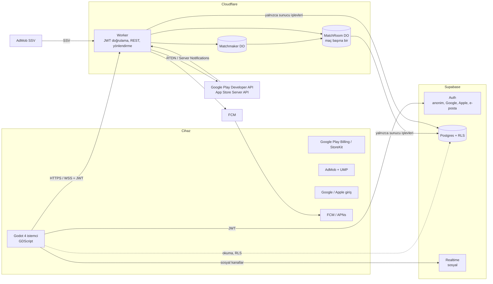

# TECHNICAL_ARCHITECTURE — Teknik Mimari

> **Durum:**
> - Faz 1 taslağı (2026-11-16); Faz 2'de güncellendi.
> - **Faz 2 sonrası güncellemede (2026-11-17) sunucu mimarisi değişti.**
>
> **Değişikliğin özeti** (K-36, kesin):
> - Kiralık VPS / VDS üzerinde Node.js + Redis **artık başlangıç hedefi değil**.
> - Çevrimiçi altyapı: **Cloudflare Workers + Durable Objects** (yetkili oyun sunucusu) ve **Supabase** (Auth, Postgres, Realtime sosyal).
> - Node.js ve Redis kullanılamaz sayılmıyor: alternatif ve ölçek seçeneği olarak korunuyor (§16).
>
> **Bu belge genel bakıştır.** Çevrimiçi sistemin ayrıntısı `docs/architecture/` altında:
>
> | Konu | Belge |
> |---|---|
> | Genel çevrimiçi mimari, maç yaşam döngüsü | [architecture/ONLINE_ARCHITECTURE.md](architecture/ONLINE_ARCHITECTURE.md) |
> | Cloudflare (limitler, DO tasarımı, motorun uyumu) | [architecture/CLOUDFLARE_ARCHITECTURE.md](architecture/CLOUDFLARE_ARCHITECTURE.md) |
> | Supabase (Auth, veri, RLS, Realtime) | [architecture/SUPABASE_ARCHITECTURE.md](architecture/SUPABASE_ARCHITECTURE.md) |
> | Güvenlik | [architecture/SECURITY_ARCHITECTURE.md](architecture/SECURITY_ARCHITECTURE.md) |
> | Maliyet ve ölçek | [architecture/COST_AND_SCALING.md](architecture/COST_AND_SCALING.md) |
>
> **Karar bekleyen teknik konular:**
> - K-35, K-38, K-39, K-40, K-49;
> - K-58…K-62, K-64 (DECISIONS §8).
>
> Doğrulanmamış teknik ayrıntılar **(doğrulanacak)** olarak işaretli.

## 1. Genel görünüm



**Sorumluluk ayrımı:**

| Bileşen | Sorumluluk |
|---|---|
| **İstemci** | Görüntü, giriş (input), animasyon, çevrimdışı pratik. **Hiçbir sonucu belirlemez.** |
| **Cloudflare Worker** | JWT doğrulama, hız sınırı, yönlendirme; ödül, satın alma doğrulama ve mağaza işlemleri (REST) |
| **Matchmaker / MatchRoom (Durable Objects)** | Eşleştirme; **otoriter maç durumu**, zar, kurallar, süreler, kopma, maç sonu |
| **Supabase** | Kimlik; kalıcı veri; **bakiye ve defterin tek kaynağı**; RLS. İstemci yalnızca okur. Yazmalar sınırlı yetkili sunucu işlevleriyle yapılır. |
| **Supabase Realtime** | Çevrimiçi durumu, davet, sosyal bildirim. **Yetkili oyun motorunun yerine geçmez.** |

## 2. Mimari seçeneklerin değerlendirmesi

| Seçenek | Durum | Artısı | Eksisi |
|---|---|---|---|
| **A. Cloudflare Workers + DO + Supabase** | ✅ **Seçildi** (2026-11-17) | Sunucu kirası ve bakımı yok; maç başına tek iş parçacıklı nesne (kilitsiz otorite); geliştirmede 0 maliyet; TS motoru küçük uyarlamayla çalışıyor (ölçüldü) | Ücretsiz plan yayına yetmez; kullanım bazlı maliyet; Cloudflare'e bağımlılık; DO yerleşimi tam kontrol edilemez |
| B. Supabase + VPS üzerinde Node.js + Redis | Önceki plan; **alternatif** | Tam kontrol, sabit maliyet | Sunucu işletme yükü, aylık kira, Redis gerekliliği |
| C. Nakama | Değerlendirildi, seçilmedi | Hazır sosyal ve eşleştirme sistemleri | Kendi barındırma yükü; Supabase ile çakışma |

**Godot için resmi Supabase SDK'sı yok.** REST (GoTrue / PostgREST) ve Realtime (WebSocket protokolü) çağrıları ince bir GDScript istemcisiyle yapılır. Realtime protokolünün GDScript'te uygulanması Faz 4'te doğrulanacak.

## 3. İstemci (Godot 4)

- **Sürüm:** Godot 4.7.2 (K-50); GDScript, statik tiplerle.
- **Yön, ölçekleme, renderer:** Faz 2'de uygulandı. Ayrıntı `client/README.md`:
  - yalnızca dikey;
  - 720×1560 referans, `canvas_items`;
  - Compatibility renderer.
- **Ağ:**
  - REST için `HTTPRequest` (JSON); gerçek zamanlı için `WebSocketPeer` (WSS, TLS doğrulamalı).
  - Bağlantı yöneticisi tek bir autoload (`Net`): yeniden bağlanma, istek kimliği, protokol ping (NETWORK_PROTOCOL §1).
- **Durum yönetimi:**
  - İstemci, sunucudan gelen olayları sırayla uygular.
  - Animasyonlar bir olay kuyruğundan oynatılır. Faz 2'deki `MatchController` / `MatchScreen` yapısı aynı olay biçimini kullanır.
- **Çevrimdışı pratik:**
  - GDScript kural motoru (`client/scripts/game/rules/`) + bot.
  - Ortak JSON test vektörleriyle TS motoruna eşitliği CI'da doğrulanır (Faz 2'de %100).
- **Yerel eklentiler:** COMPATIBILITY_REPORT.md. Hiçbiri kurulmadı. IAP, reklam ve giriş eklentileri Gradle derlemesi gerektiriyor.

## 4. Kimlik ve hesaplar

- **Supabase Auth:**
  - misafir için anonim giriş;
  - Google ve Apple için yerel kimlik belirteciyle `signInWithIdToken`;
  - e-posta + şifre.
- **Misafiri yükseltme:** Manual linking açıkken `updateUser` / `linkIdentity` / `linkIdentityWithIdToken`; kullanıcı kimliği değişmez (USER_FLOWS §3). Canlı doğrulama Faz 3'te.
- **Belirteçler:**
  - Erişim JWT'si kısa ömürlü; yenileme belirteci cihazın güvenli deposunda.
  - Cloudflare JWT'yi **asimetrik imzalama anahtarlarının genel anahtarıyla** (JWKS) doğrular: imza, `exp`, `aud`, `iss`, `sub`.
  - Cloudflare'de JWT gizli anahtarı **tutulmaz** (SUPABASE_ARCHITECTURE §3).
- **Profil oluşturma:** İlk girişte Worker, sunucu işleviyle `profiles` satırını oluşturur: görünen ad, 4 haneli etiket, varsayılan avatar.
- **Hesap silme:** USER_FLOWS §12; zamanlanmış iş gün 30'da siler (SUPABASE_ARCHITECTURE §8).

## 5. Sunucu servisleri

> **Değişti (2026-11-17):** Node.js `api` / `realtime` / `worker` süreçleri yerine:
>
> | Eski rol | Yeni karşılığı |
> |---|---|
> | `api` | Cloudflare Worker uçları |
> | `realtime` | Matchmaker + MatchRoom Durable Objects |
> | `worker` | Cloudflare Cron Trigger ya da Supabase `pg_cron` |
>
> Ayrıntı: CLOUDFLARE_ARCHITECTURE §3.

- **Paketler:**

| Paket | İçerik |
|---|---|
| `server/game-engine` | Saf kural motoru (Faz 2; 73 test). Node'da test edilir, Workers'ta çalışır. |
| `server/worker` (Faz 3) | Worker + DO sınıfları; motoru içe aktarır |
| Protokol şemaları (Faz 4) | Mesaj şemaları + tipler; istemci testlerinde de kullanılır |

- **Veritabanı erişimi:** Yalnızca belirli sunucu işlevlerini çağırma yetkisi olan `game_server` rolüyle (Hyperdrive; K-59).
  - Ekonomik işlemler tek bir SQL işlemi içinde (§11).
  - Service role anahtarı istemcide asla yer almaz; tercihen sunucuda da kullanılmaz (SECURITY_ARCHITECTURE §2).

## 6. Otoriter maç ve zar

- **Maç nesnesi:** Her maç bir `MatchRoom` Durable Object'idir. Tek iş parçacıklıdır; durumu kendi SQLite deposunda tutar (CLOUDFLARE_ARCHITECTURE §3.3).
- **Eylem işleme:**
  1. bağlantı → koltuk eşleşmesi;
  2. `turnId` ve aşama güncel mi;
  3. `reqId` tekrarı mı (idempotency);
  4. kural motoru `apply`;
  5. yeni durum kalıcı yazılır;
  6. oyunculara yayın.
- **Zar:**
  - Kriptografik rastgele sayı üreteci (Web Crypto), reddetme örneklemesi (modulo sapması yok).
  - Zar yalnızca "zar at" eylemi geçerli olduğunda üretilir. **Üst üste iki 6'dan sonraki atış yalnızca 1–5** (GAME_RULES §6.2).
  - İstemciden zar kabul edilmez.
- **Denetlenebilirlik (v1.1 önerisi):**
  - Maç başında `seed` üretilir, `hash(seed)` oyunculara gönderilir.
  - Zarlar `HMAC(seed, turnIndex)` ile türetilir; maç sonunda `seed` açıklanır.
  - §6.2 kuralı da bu türetmeye dahil edilir: iki 6'dan sonraki atışta 1–5 aralığına eşleme.
  - `seed` maç boyunca yalnızca MatchRoom'da gizli kalır. MVP'de doğrudan kriptografik üreteç yeterli.
- **Zaman aşımları:** Sunucu zamanlayıcısı (DO Alarm) tek otoritedir. İstemci sayacı `deadline`'a ve saat farkı düzeltmesine göre çizilir.
- **Otopilot ve bot:** Motorun `chooseBotMove` işlevi; bot ve otopilot için aynı kod.

## 7. Eşleştirme

- **Kuyruk:** Mod × giriş seviyesi başına bir `Matchmaker` Durable Object; kuyruk nesnenin kendi deposunda. Eski plandaki Redis sıralı kümesinin yerine geçer.
- **Döngü:**
  - Yeterli oyuncu (2 ya da 4) toplanınca engelleme kontrolü yapılır.
  - 2 kişilikte renk tercihleri uygulanır (K-55).
  - MatchRoom oluşturulur; altınlı seviyede emanet alınır; oyunculara `match.found` + bilet gönderilir.
- **Beceri eşleştirmesi:** MVP'de yok.
- **Bölge:** DO yerleşimi ilk isteğe yakın; ipucu K-62. TR'den gecikme ~30–70 ms beklenir (**tahmin**, Faz 5'te ölçülecek).
- **Bot önerisi (K-05):** Süre eşiği aşılınca teklif; bot "Bot" etiketli, gizlenmez.
- **Ceza ve kısıtlar:** Kuyruğa girerken kontrol edilenler:
  - terk cezası;
  - hesap askısı;
  - sürüm uyumu;
  - altınlı seviyede bakiye ve borç.

## 8. Oda ve maç yönetimi, kopma ve kurtarma

- **Yönlendirme:** Maç kimliği doğrudan nesneyi belirler (`idFromName` / `newUniqueId`). "Hangi süreçte" eşlemesi ve devralma mantığı **gerekmez**.
- **Kalıcılık:** Durum her eylemden sonra nesnenin deposuna yazılır (strateji K-60). Alarm kalıcıdır.
- **Nesne yeniden başlarsa:** Durum depodan yüklenir; istemciler yeniden bağlanıp tam durumu alır.
- **Kurtarılamazsa:** Maç `void`; emanetler iade, ödül ve ceza yok, telafi bildirimi (GAME_RULES §11.8).
- **Maç sonu kaydı:**
  - Sonuç önce DO deposundaki `outbox`'a yazılır.
  - `settle_match` (tek işlem, idempotent) Postgres'e yazar; başarısızlıkta alarmla tekrar denenir (24 saate kadar).
  - Mutabakat işi sonuçlanmamış emanetleri iade eder.
- **Kopma tespiti:** İstemcinin protokol ping'i + `webSocketClose` (NETWORK_PROTOCOL §1). Uygulama ön plana dönünce istemci bağlantıyı hemen yeniler.

Ayrıntı: CLOUDFLARE_ARCHITECTURE §3, §6; SECURITY_ARCHITECTURE §7.

## 9. Sosyal gerçek zamanlılık, bildirimler ve Supabase Realtime

- **Supabase Realtime** (K-53, kesin): arkadaşların çevrimiçi durumu, davetler ve sosyal bildirimler.
  - Özel kanallar ve RLS ile yetkilendirme.
  - **Maç durumu taşımaz.**
- **İki bağlantı riskinin çözümü:** Realtime bağlantısı yalnızca menülerde açık; maç sırasında kapatılır, durum "maçta" olarak yazılır. Böylece telefonda aynı anda tek kalıcı bağlantı olur (SUPABASE_ARCHITECTURE §7).
- **Davet:** `notifications` satırı (kalıcı) + Realtime Broadcast; uygulama kapalıysa push. Kaçan davet gelen kutusunda kalır.
- **Push:** FCM (Android + iOS APNs anahtarıyla) (K-39).
  - Cloudflare Worker FCM HTTP v1 API'sini çağırır; servis hesabı imzası Web Crypto ile (**doğrulanacak**).
  - `device_tokens` tablosu.
  - Sıklık sınırları ve sessiz saatler (22:00–09:00, yalnızca hatırlatmalar).
- **Gelen kutusu:** `notifications` tablosu (RLS: yalnızca kendi kayıtları).

## 10. Ölçeklenebilirlik

- **Ölçek modeli:** Her maç ayrı bir nesne olduğu için maç sayısı arttıkça Cloudflare nesneleri kendiliğinden dağıtır. "Süreç kapasitesi" sınırı yoktur; sınırlar **kota ve maliyettir**.
- **Darboğaz adayları:**
  - DO satır yazma maliyeti (K-60);
  - Matchmaker nesnesi başına 1.000 istek / sn yumuşak sınırı (gerekirse kuyruk bölünür);
  - Supabase Realtime bağlantı ve mesaj kotaları;
  - Postgres bilgi işlem boyutu.
- **Rakamlar:** 100 / 500 / 1.000 eşzamanlı oyuncu tahminleri COST_AND_SCALING.md'de. Gerçek değerler Faz 5'te ölçülecek.

## 11. Veritabanı erişim hataları ve tutarlılık

- **Ekonomi işlemleri:** Her ekonomik değişiklik **tek bir Postgres işleminde** yapılır: `wallet_transactions` (benzersiz `idempotency_key`) + bakiye + envanter / emanet.
  - Aynı anahtar ikinci kez gelirse işlem yapılmaz, önceki sonuç döner.
  - Bakiyeler `CHECK (>= 0)`; **istisna yok**. İade sonrası açık, borç kaydına yazılır (E-6).
- **Geçici hatalar:** 3 deneme, 100–800 ms üstel geri çekilme. Kalıcı hatada `TRY_AGAIN`; ödül talebi "bekliyor" kalır.
- **Supabase saatlerce erişilemezse:**
  - süren maçlar devam eder (hamle başına DB çağrısı yok);
  - sonuçlar DO `outbox`'ında bekler;
  - yeni altınlı maç (emanet) açılmaz;
  - giriş ve profil işlemleri çalışmaz; uygulama "Bakım" moduna geçer.
- **Okuma önbelleği:** Kozmetik katalog ve yapılandırma istemcide sürümlü önbellekte (`config_version`).

## 12. Günlükleme ve izleme

- **Günlükler:** Yapılandırılmış JSON. `traceId`, `userId` (takma), `matchId`, `event`.
  - Kişisel veri, JWT ve anahtar günlüğe yazılmaz.
  - Kaynaklar: Cloudflare Workers günlükleri ve analitiği, Supabase günlükleri. Toplama aracı K-40.
- **Metrikler:**
  - aktif maç; kuyruk bekleme (p50 / p95);
  - eylem gecikmesi;
  - hata oranları;
  - `settle_match` birikimi;
  - IAP doğrulama hataları;
  - **kota kullanımı** (DO istek, satır yazma, süre; Realtime bağlantı ve mesaj).
- **Uyarılar:**

| Uyarı | Eşik |
|---|---|
| Eylem gecikmesi p95 | > 250 ms |
| Kuyruk bekleme p95 | > 60 sn |
| Bekleyen sonuç kaydı | > 100 |
| 5xx oranı | > %1 |
| IAP doğrulama başarısızlığı | > %2 |
| Günlük / aylık kota kullanımı | %70 ve %90 |

- **İstemci:** Çökme raporlama (K-40); analitik olayları (onaylı kullanıcılarda).
- **Maç denetim izi:** Her maçın kompakt eylem dizisi maç bitince `match_events`'e yazılır ve 90 gün saklanır. Motor belirleyici olduğu için maç birebir yeniden oynatılabilir (COST_AND_SCALING §4).

## 13. Yedekleme ve felaket kurtarma

- **Postgres:**
  - Supabase Pro'nun günlük yedekleri (7 gün). Ücretsiz planda otomatik yedek **yok**; prod için Pro önerisi (K-38).
  - Zamanda geri dönüş (PITR) yayın öncesi değerlendirilir (ücretli).
  - Haftalık mantıksal döküm, ayrı ve şifreli bir depolamada.
- **Durable Objects:** Yalnızca süren maçlar ve kuyruklar. Kaybı, ilgili maçların geçersiz sayılması ve emanet iadesi demektir (kabul edilen risk; olasılığı düşük).
- **Hedefler:** RPO ≤ 24 sa (Pro günlük yedek) ya da ≤ 5 dk (PITR ile); RTO ≤ 1 sa.
- **Tatbikat:** Yılda iki kez geri yükleme tatbikatı.
- **Gizli anahtarlar:** Cloudflare gizli anahtarları + bir gizli anahtar yöneticisi. Depoda ve belgelerde gerçek anahtar **yok**.

## 14. Ortamlar ve teslim süreci

| Ortam | Cloudflare | Supabase |
|---|---|---|
| `local` | `wrangler dev` (workerd) | Supabase CLI yerel yığın |
| `dev` | Ayrı ortam | Ücretsiz proje |
| `staging` | Ayrı ortam; mağaza sandbox, test reklamları | Ayrı proje |
| `prod` | Ayrı ortam | Pro proje (K-38) |

- **CI:**
  - kural motoru testleri + ortak vektörler (TS ve GDScript);
  - workerd içinde motor ve DO testleri;
  - RLS ve sunucu işlevi testleri;
  - protokol şema denetimi;
  - istemci derlemesi.
- **Veritabanı geçişleri:** `supabase/migrations` (RLS dahil), sürüm kontrolünde.
- **Sürüm uyumu:** İstemci `clientVersion` gönderir; altı reddedilir (zorunlu güncelleme). Protokol değişiklikleri geriye uyumlu eklenir.

## 15. Depo yapısı (Faz 2 sonu gerçek durum + plan)

```
KizmaBirader/
  docs/                      ← belgeler; docs/architecture/, docs/economy/
  shared/
    rules_test_vectors/      ← ortak kural testleri (Faz 2)
    config/                  ← örnek ekonomi yapılandırması (Faz 2)
    protocol/                ← (Faz 4) mesaj şemaları
  client/                    ← Godot projesi (Faz 2)
  server/
    game-engine/             ← TS kural motoru (Faz 2)
    worker/                  ← (Faz 3) Cloudflare Worker + Durable Objects
  supabase/                  ← (Faz 3) migrations/, seed.sql, testler
  build/                     ← APK çıktıları
```

## 16. Önceki mimari (alternatif olarak korunan)

| Bileşen | Ne zaman yeniden değerlendirilir |
|---|---|
| **Node.js oyun sunucusu** (VPS / VDS ya da yönetilen konteyner) | Cloudflare maliyeti ölçekte öngörülenden çok yüksek çıkarsa, DO yerleşimi kabul edilemez gecikme verirse ya da platform kısıtı ortaya çıkarsa. Motor platformdan bağımsız tutulduğu için geçiş maliyeti sınırlı: aynı `GameEngine` ve `MatchSession`. |
| **Redis** | Durable Objects'in karşılayamadığı ölçülmüş bir ihtiyaç olursa: çok bölgeli küresel kuyruk, çok yüksek hızda canlı sıralama, paylaşımlı hız sınırı vb. |

Faz 1'deki bu yapının ayrıntıları bu belgenin 2026-11-16 sürümündeydi. Kararın geçmişi: DECISIONS §8.3.
