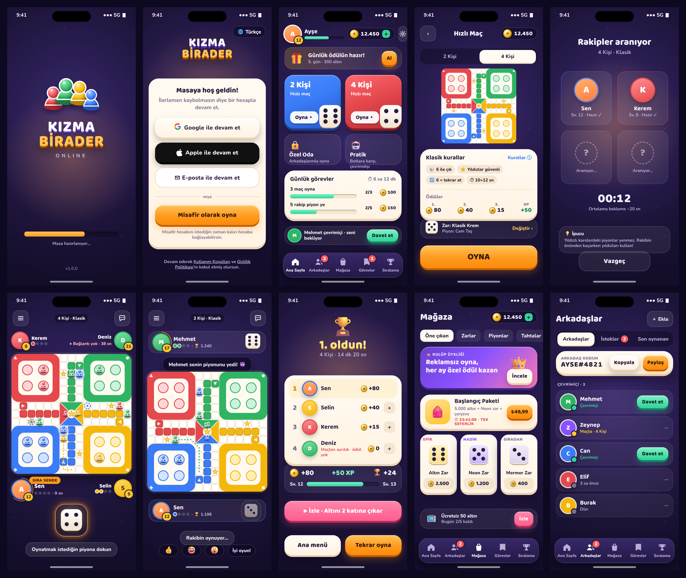

# UI_UX_DESIGN_SYSTEM — Görsel Kimlik ve Tasarım Sistemi

> **Durum:** Faz 1 taslağı (2026-11-16). Konsept önerisi: **"Akşam Masası"** (K-41, onay bekliyor).
>
> **Prototipler:** `docs/design/screens/` (10 ekran, 1080×2340) ve `docs/design/screens/overview.png`. Kaynak: `docs/design/_src/` (HTML / CSS; değerler bu belgeyle aynı).
>
> **Kapsam:** Bütün değerler yalnızca **dikey ekran** içindir. Birim **pt**'dir (iOS pt = Android dp); 1 pt = 1 CSS px.



## 1. Konsept: "Akşam Masası"

- **Fikir:** Akşam, sıcak bir lambanın altında, arkadaşlarla kurulmuş bir oyun masası.
- **Zemin:** Koyu mürdüm ve gece mavisi; çok soluk yıldızlarla dolu bir gece gökyüzü. Yıldız, tahtadaki güvenli karelerin işaretiyle aynı motiftir ve markanın imzasıdır.
- **Tahta:** Ekranın ortasında lamba ışığı alan, cilalı, sıcak krem renkli bir oyun nesnesi.
- **Arayüz:** İki katmandan oluşur:
  - gece zeminde **yarı saydam koyu cam** paneller (bilgi);
  - **krem kartlar** (asıl içerik ve kararlar).
- **Eylem renkleri:** Mango turuncusu (ana eylem), böğürtlen pembesi (reklam / ödül), nane (sosyal / olumlu), altın (para).
  - Bunlar oyuncu renklerinden (kırmızı / yeşil / sarı / mavi) **bilinçli olarak ayrık** seçildi, böylece arayüz ile tahta karışmaz.
- **His:** Kalın alt kenarlı, basınca gömülen "dokunsal" butonlar; yuvarlak, dostça bir başlık fontu; cömert boşluk. Hazır şablon görüntüsünden kaçınmak için:
  - kendine özgü yıldız motifi;
  - sıcak ışık hâlesi;
  - kendi piyon silueti;
  - tutarlı, tek elden çizilmiş ikon seti.
- **Kaçınılanlar:** Kalabalık süsleme, metalik bevel ve parlak "kumarhane" estetiği, neon aşırılığı, her şeyin parlaması.

**Onay için alternatif yönler** (K-41; istenirse Faz 2'nin başında prototiplenir):
- **B "Kahvehane Ahşap":** açık meşe zemin, keçe dokusu, sıcak kahverengi tonlar, daha nostaljik.
- **C "Neşeli Pastel":** gün ışığı, açık pastel zemin, beyaz kartlar, daha genç ve hafif.

## 2. Renk paleti

### 2.1 Zemin (gece)

| Token | Hex | Kullanım |
|---|---|---|
| `night.900` | `#140E2B` | En koyu kenar, alt sistem çubuğu arkası |
| `night.800` | `#1D1438` | Varsayılan ekran zemini |
| `night.700` | `#2A1D52` | Zemin degradesinin orta tonu |
| `night.600` | `#3A2A6B` | Lamba ışığının merkezi, alt menü |
| `glow` | `rgba(255,168,76,.22)` | Tahta ve logonun arkasındaki sıcak hâle |

**Ekran zemini:**
- radyal degrade: `night.600` (%0, merkez %38 yükseklikte) → `night.700` (%38) → `night.800` (%70) → `night.900` (%100);
- üstüne yıldız dokusu (opaklık %55, 300 pt'de bir tekrarlanır).

### 2.2 Yüzeyler ve yazı

| Token | Hex | Kullanım |
|---|---|---|
| `cream.50` | `#FFFAF2` | Kartın üst tonu |
| `cream.100` | `#FFF3E2` | Kartın alt tonu, açık buton |
| `cream.200` | `#F5E6CF` | Kart içi bölmeler, etiketler |
| `cream.300` | `#E8D3B4` | Kartın 3B alt kenarı, ayraç |
| `ink.900` | `#2A1F3D` | Krem üzerinde ana yazı |
| `ink.700` | `#4B3F62` | İkincil yazı |
| `ink.500` | `#7A6D91` | Yardımcı yazı, pasif |
| `on-night` | `#F6EFFF` | Gece zeminde ana yazı |
| `on-night-dim` | `#B9ADD6` | Gece zeminde ikincil yazı |
| `glass` | `rgba(255,255,255,.07)` + kenar `rgba(255,255,255,.12)` | Koyu cam panel |

### 2.3 Eylem ve durum

| Token | Hex | Rol |
|---|---|---|
| `mango.300 / 500 / 700` | `#FFC35A / #FF9A1F / #C25F00` | **Ana eylem** (Oyna, Al, Devam). Yazı `mango.ink #3D1C00`. |
| `berry.500` (kenar `#B8295A`) | `#FF5D8F` | Ödüllü reklam ve ödül ikiye katlama |
| `mint.500` (kenar `#13875F`) | `#2FD39A` | Sosyal ve olumlu: davet et, kabul, çevrimiçi, ilerleme çubuğu |
| `gold.300 / 500 / 700` | `#FFE08A / #FFC531 / #C88A00` | Altın, seviye rozeti, 1.'lik |
| `danger.500` | `#FF5A5F` | Sayaç balonu, hata, bağlantı yok |
| `premium` | `#6A3FD0 → #8A52FF → #FF7AB0` | Yalnızca Kulüp Üyeliği yüzeyleri |

**Kontrast** (WCAG 2.2, hesaplanacak; Faz 3 kabul ölçütü):
- Normal yazı ≥ 4.5:1; 18 pt üstü kalın yazı ve ikonlar ≥ 3:1.
- Mango buton üzerindeki koyu kahve yazının kontrastı beyaz yazıdan yüksektir; bu yüzden ana butonda beyaz yazı kullanılmaz.

### 2.4 Oyuncu renkleri

| Renk | Ana | Koyu (kenar / gölge) | Yumuşak (alan içi) | Açık (parlama) | Sembol |
|---|---|---|---|---|---|
| Kırmızı | `#E5484D` | `#A8262B` | `#FFD5D6` | `#FF8E91` | ▲ |
| Yeşil | `#2FB463` | `#1C7A40` | `#CDF2DC` | `#7BE0A3` | ● |
| Sarı | `#F5B70A` | `#B27F00` | `#FFEEB8` | `#FFD968` | ■ |
| Mavi | `#3A7BF7` | `#1F4FB8` | `#D5E3FF` | `#86ADFF` | ◆ |

- **Kural:** Oyuncu renkleri **yalnızca** oyuncuya ve tahtaya ait öğelerde kullanılır: piyon, alan, avatar halkası, sıra göstergesi. Butonlarda ve menülerde kullanılmaz.
- **İstisna:** Ana menüdeki "2 Kişi" (mavi) ve "4 Kişi" (kırmızı) kartları mod kimliği için oyuncu tonunu taşır. Bu bilinçli bir istisnadır; mod kartları tahta dışında olduğu için karışıklık yaratmaz.

## 3. Tasarım tokenları

Godot'ya aktarılırken tek bir `ui_tokens.gd` ve `ui_palette.gd` dosyasında tutulur. JSON karşılığı:

```json
{
  "space": { "1": 4, "2": 8, "3": 12, "4": 16, "5": 20, "6": 24, "8": 32, "edge": 16 },
  "radius": { "s": 10, "m": 16, "l": 22, "xl": 28, "pill": 999, "board": 22 },
  "size": { "touch_min": 44, "button_l": 56, "button_xl": 64, "button_s": 40, "icon_button": 44,
            "avatar_l": 64, "avatar_m": 52, "avatar_s": 38, "nav_height": 70, "dice_pad": 92 },
  "elevation": {
    "button_edge": 5, "card_edge": 6,
    "shadow_card": "0 16 30 rgba(10,4,30,.45)", "shadow_button": "0 10 22 accent@35%"
  },
  "motion": { "instant": 90, "fast": 160, "base": 240, "slow": 360, "celebrate": 900,
              "ease_out": "cubic-bezier(.2,.8,.2,1)", "ease_back": "cubic-bezier(.34,1.56,.64,1)" },
  "safe": { "min_top": 24, "min_bottom": 16 }
}
```

## 4. Tipografi

- **Başlık ve sayılar:** **Baloo 2** (SIL OFL); yuvarlak, sıcak ve kalın.
- **Gövde ve etiketler:** **Nunito** (SIL OFL); dostça, küçük boyda okunaklı.
- **Türkçe kapsam:** İki fontta da ğ Ğ ş Ş ı İ ç Ç ö Ö ü Ü ve ₺ var (prototip aşamasında doğrulandı).
- **Ertelenen font:** Arapça için Noto Sans Arabic yedek olarak zincirlenir (v1.1+).

| Stil | Font / ağırlık | Boyut / satır | Kullanım |
|---|---|---|---|
| `display` | Baloo 2 / 800 | 34 / 1.0 | "1. oldun!", sayaç |
| `h1` | Baloo 2 / 800 | 26 / 1.1 | Ekran başlıkları |
| `h2` | Baloo 2 / 800 | 20 / 1.15 | Kart başlıkları, büyük sayılar |
| `h3` | Baloo 2 / 700 | 17 / 1.2 | Oyuncu adı, liste başlıkları |
| `button` | Baloo 2 / 800 | 18 (L), 15 (S), 24 (XL) | Buton yazısı |
| `body` | Nunito / 700 | 15 / 1.35 | Paragraf |
| `label` | Nunito / 800 | 13 / 1.2 | Etiket, liste satırı |
| `caption` | Nunito / 700 | 12 / 1.25 | Yardımcı bilgi |
| `micro` | Nunito / 900, büyük harf, +0.6 aralık | 10.5 | Rozet, nadirlik etiketi |

**Kurallar:**
- En küçük yazı 10.5 pt ve yalnızca büyük harf etiketlerde; okunacak metin en az 12 pt.
- Sayılar `tabular-nums` (değişen sayılar titremez).
- Büyük harfe çevirme Türkçe kurallarıyla yapılır (i → İ). Godot'da `to_upper()` dile duyarlı değildir; yerelleştirilmiş büyük harf metni çeviri dosyasında tutulur (LOCALIZATION §5).
- **Dinamik yazı boyutu:** Sistem yazı ölçeği %85–%130 aralığında desteklenir. Üstünde, düzen bozulmasın diye ölçek sınırlanır (ayarlarda "Büyük yazı" seçeneği v1.1).

## 5. Bileşenler

### 5.1 Butonlar

| Tür | Görünüm | Ne zaman |
|---|---|---|
| **Primary** (mango) | Degrade `mango.300 → mango.500`, 5 pt koyu alt kenar, renkli gölge, üstte 2 pt parlak çizgi | Ekran başına **tek** ana eylem: Oyna, Al, Devam |
| **Secondary** (krem) | Krem degrade, `cream.300` alt kenar | İkincil eylem: Ana menü, Kopyala |
| **Ghost** | %8 beyaz cam, 1.5 pt kenar | Vazgeç, filtre, gece zeminde düşük öncelik |
| **Berry** | Pembe degrade | Yalnızca reklam izleme ve ödül |
| **Mint** | Nane degrade | Davet et, kabul et |
| **Icon** | 44×44, köşe 15, cam | Ayarlar, menü, sohbet |

- **Boyutlar:** L 56 (varsayılan), XL 64 (OYNA), S 40 (kart içi). Dokunma alanı **en az 44×44**.
- **Durumlar:**

| Durum | Görünüm |
|---|---|
| Normal | Yukarıdaki görünüm |
| Basılı | İçerik 4 pt gömülür, alt kenar 1 pt'ye iner, 90 ms |
| Pasif | %45 doygunluk, alt kenar yok; dokunulursa nedeni bir ipucu balonunda gösterilir |
| Yükleniyor | Yazı yerine 3 nokta animasyonu; genişlik sabit kalır |

- **Ödül etiketi:** Ödül veren butonlarda ödül miktarı buton içinde sağda bir hap olarak durur.

### 5.2 Kartlar ve paneller

- **Krem kart:** köşe 28, 6 pt `cream.300` alt kenar + yumuşak gölge, iç boşluk 14–22. İçerik ve kararlar içindir.
- **Cam panel:** köşe 22, %7 beyaz + %12 beyaz kenar. Bilgi ve liste içindir.
- **Açılır pencere:** Ekranın %88 genişliğinde, en fazla 420 pt; krem kart; arkada %55 gece perdesi.
  - Açılırken `ease_back` ile ölçek 0.92 → 1 (240 ms); kapanırken `ease_out` (160 ms).
- **Alt sayfa (bottom sheet):** Uzun listeler ve seçimler için. Tutamak 36×5; aşağı çekince kapanır.

### 5.3 Diğer bileşenler

| Bileşen | Tanım |
|---|---|
| **Hap** (pill) | 34 pt; altın ve seviye göstergeleri; "+" ile mağazaya gider |
| **Rozet** | 20 pt kırmızı daire, sayı; menü sekmelerinde |
| **Avatar** | Daire. Boyutlar: L 64, M 52, S 38. Oyuncu rengi halkası (3 pt); sağ altta seviye rozeti; sırada sayaç halkası (conic-gradient). |
| **İlerleme çubuğu** | 12 pt (XP 8 pt); nane dolgu, gömme yatak |
| **Sekme** (segment) | Koyu yatak; seçili sekme krem ve 3 pt kenarlı |
| **Alt menü** | 5 sekme (Ana Sayfa · Arkadaşlar · Mağaza · Görevler · Sıralama); 70 pt yüksek, köşe 26, cam |
| **Bildirim** (toast) | Üstten kayarak gelir, 2.5 sn, en fazla 2 satır; türüne göre ikon |
| **Boş durum** | İllüstrasyon (120 pt) + başlık + tek cümle + tek buton |
| **İskelet yükleme** | Kart biçiminde %6 beyaz bloklar, 1.2 sn parlayan geçiş |

## 6. Hareket, ses ve titreşim

### 6.1 Hareket süreleri

| Olay | Süre / eğri | Not |
|---|---|---|
| Buton basma | 90 ms | Gömülme |
| Ekran geçişi | 240 ms `ease_out` | Yeni ekran 24 pt sağdan kayar + saydamlık; geri giderken ters yön |
| Açılır pencere | 240 ms `ease_back` | |
| Zar atma | 600 ms | Zar döner ve sallanır; sunucu sonucu gelmeden **en az 350 ms** döner, sonuç gelince en geç 250 ms içinde durur |
| Piyon adımı | Kare başına 90 ms, zıplama yüksekliği 0.35 hücre | 6 kare ≈ 540 ms |
| Yeme | 450 ms | Yenen piyon yayla bekleme alanına uçar; ekran 4 pt, 120 ms sarsılır |
| Bitiş | 600 ms | Üçgene süzülme ve yıldız parıltısı |
| Maç sonu kutlaması | 900–1.400 ms | Konfeti; dokununca atlanır |

- **Maç hızı kuralı:** Bir turun zorunlu animasyonları toplamda **1.6 sn'yi** geçmez (zar + 6 adım + yeme). "Hızlı animasyon" ayarı bütün süreleri %35 kısaltır.
- **Azaltılmış hareket:** Sistem tercihi açıksa sarsıntı, konfeti ve zıplama kapanır; yerlerine kısa geçişler kullanılır.

### 6.2 Ses ve titreşim

| Olay | Ses | Titreşim |
|---|---|---|
| Zar | Ahşap masada zar tıkırtısı | Hafif |
| Adım | Yumuşak "tık" | — |
| Yeme | Kısa "pop" ve hüzünlü düşüş | Orta |
| Bitiş | Çan | Hafif çift |
| Sıra sende | Yumuşak gong | Hafif |
| Son 3 saniye | Tik-tak | Hafif, her saniye |

- **Müzik:** Menüde sakin, sıcak, akustik; maçta daha alçak.
- **Kaynak:** Ses ve müzik kaynağı karar bekliyor (K-43).

## 7. Tahta ve piyon görselleri

### 7.1 Tahta

- **Zemin:** Krem `#FFF6E6`, köşe yarıçapı 0.9 hücre. Çevresinde 5 pt %8 beyaz hâle ve derin gölge (`0 18 40 rgba(0,0,0,.5)`) var.
- **Bekleme alanları:** Renkli dış alan; içte krem bir pano (köşe 0.75 hücre). 4 yuva, yumuşak renkle doldurulmuş ve renkli kenarlı dairelerdir. Dış köşede renk sembolü durur.
- **Parkur:** Beyaz hücreler, aralarında 0.06 hücre boşluk, köşe 0.2 hücre, kenar `#EAD7BB`.
  - Başlangıç kareleri dolu renkli ve üzerinde beyaz ok var.
  - Yıldızlar altın sarısı (`#FFD04A`, kenar `#D49A00`).
- **Koridorlar:** Dolu renkli hücreler.
- **Orta bitiş:** Dört renk üçgeni; ortada krem daire içinde altın yıldız.

### 7.2 Piyon

- **Siluet:** Taban elipsi + konik gövde + yuvarlak baş. Satranç piyonu ile kalem ucu arası, kendine özgü bir şekil.
- **Renk ve ışık:** Radyal degrade (sol üstten ışık), 0.06 hücre beyaz kontur, yumuşak gölge.
- **Ölçü:** Boyu ~1 hücre, genişliği 0.7 hücre. Gövdede beyaz renk sembolü.
- **Durumlar:**

| Durum | Görünüm |
|---|---|
| Seçilebilir | Renkli parlama + beyaz hâle halkası, 1.2 sn nabız |
| Seçili | Yarım hücre büyür |
| Hedef kare | Kesikli renkli halka + merkez nokta |
| Son hamle izi | Kesikli renkli çizgi, 2 sn içinde soluklaşır |

- **Aynı karede birden çok piyon:** Piyonlar yatayda 0.32 hücre aralıkla, hafif yukarı kayarak dizilir. Sayı 3'ü geçerse "×4" rozeti gösterilir.

### 7.3 Zar

- **Biçim:** Krem degrade, köşe 22/100, 3B alt kenar. Noktalar `ink.900`; "1" kırmızı (Asya zarı geleneğine selam).
- **Zar alanı:** 92 pt. Sıra yerel oyuncudayken mango hâle ve nabız animasyonu olur. Sıra başkasındayken soluk durur; dokunulmaz.

### 7.4 Kozmetik kuralları (oynanabilirlik koruması)

- **Tahta temaları:** Zemin, doku, çerçeve ve yıldız biçimini değiştirebilir. Oyuncu renklerini yalnızca **±%8 ton** aralığında değiştirebilir. Sembollerin görünürlüğü korunur.
- **Piyon setleri:** Şekil ve malzeme değiştirebilir (cam, ahşap, metal, hayvan figürü). Baş ve taban kontrastı ile renk sembolü zorunludur.
  - Rakiplerin kozmetiği **onların** ekranında görünür; kendi ekranında görmek ayarla kapatılabilir ("Rakip kozmetiklerini basit göster").
- **Zar görünümleri:** Değerin okunabilirliği (nokta ve zemin kontrastı ≥ 4.5:1) zorunludur. Animasyon süresi değişmez.

## 8. Dikey düzen ve güvenli alanlar

- **Yön:** Yalnızca dikey (`portrait`). Proje ayarı `display/window/handheld/orientation = portrait`; Android'de `screenOrientation=portrait`, iOS'ta yalnızca Portrait (TECHNICAL_ARCHITECTURE §3).
  - Yatay düzen **yoktur**; tablette de dikey kalır.
- **Güvenli alanlar:** Çentik, Dynamic Island ve kamera deliği için üst güvenli alan; hareket çubuğu için alt güvenli alan `DisplayServer.get_display_safe_area()` ile okunur.
  - Bütün kenar öğeler (üst bar, alt menü, zar alanı) bu alanın içine yerleşir.
  - Zemin degradesi ve yıldızlar tam ekranı kaplar.
- **Referans tuval:** 360×780 pt (19.5:9). Desteklenen oranlar 16:9'dan 21:9'a kadar. Düzen, sabit bir üst ve alt ile esnek orta bölgeden oluşur.

| Bölge | Davranış |
|---|---|
| Üst bar (güvenli alan + 56) | Sabit |
| İçerik | Esnek; uzun ekranda boşluk eşit dağıtılır, kısa ekranda kaydırılır |
| Alt menü / alt eylem (70 + güvenli alan) | Sabit |

- **Maç ekranında tahta kare kalır:** `min(genişlik − 24, kalan yükseklik)`.
  - Kısa ekranda (16:9, ör. 360×640) oyuncu kartları tahtanın üstünde ve altında tek satıra sıkışır, zar alanı 76 pt'ye küçülür.
  - Wireframe'ler [UI_SCREEN_SPECIFICATIONS.md](UI_SCREEN_SPECIFICATIONS.md) §14'te.
- **Küçük ekran tabanı:** 320 pt genişlik (iPhone SE 1. nesil sınıfı). Bütün ekranlar 320 pt'de taşmadan çalışmalıdır (test ölçütü).
- **Tablet:** İçerik en fazla 480 pt genişlikte bir sütunda ortalanır; tahta en fazla 560 pt olur.

## 9. Erişilebilirlik

- **Renk:** Renk tek başına bilgi taşımaz. Sembol, metin ve sayı ile birlikte kullanılır; renk sembolleri varsayılan olarak açıktır (K-44).
- **Dokunma:** Hedefler en az 44 pt. Kritik butonlar (Zar, Oyna) birbirinden en az 12 pt uzakta.
- **Hareket:** "Azaltılmış hareket" ve "Hızlı animasyon" ayarları var (§6).
- **Ses:** Bütün sesli uyarıların görsel karşılığı vardır.
- **Ekran okuyucu:** Menüler için Godot erişilebilirlik (AccessKit) desteği Faz 9'da değerlendirilir. Maç içi ekran okuyucu desteği MVP dışı (açık konu).

## 10. Godot uygulama notları (Faz 3)

- **Tema:** Tek `Theme` kaynağı; tokenlar `UiTokens` / `UiPalette` sabitlerinde.
  - Butonların 3B kenarı `StyleBoxFlat` ile çizilir: `shadow_offset` + alt `border_width` + `expand_margin`. Doku gerekmez ve her çözünürlükte keskin kalır.
- **Fontlar:** `FontVariation` ile ağırlıklar ve `tnum` özelliği. Dinamik font önbelleği ve MSDF kullanılmaz.
- **İkonlar:** SVG'den içe aktarılır; 24 pt ızgara, 2 pt çizgi, köşe 2, iki ton.
- **Tahta:** Tek `Node2D` altında. Statik katmanlar (hücreler) önceden çizilmiş bir dokuya pişirilir; dinamik katmanlar (piyon, hâle) ayrı node'lardır. Zar ve piyon `Sprite2D` / `Polygon2D` ile çizilir.
- **Performans:** Arayüz için çizim çağrısı bütçesi menüde 120, maçta 80 (TESTING §6).

## 11. Görsel üretim listesi (MVP)

| Öğe | Adet | Not |
|---|---|---|
| Logo / kelime işareti | 1 + uygulama ikonu | Prototipteki kelime işareti yer tutucudur (K-01) |
| İkon seti | ~60 | Alt menü, ayarlar, durumlar |
| Avatarlar | 24 | Kaynak karar bekliyor (K-42) |
| Çerçeveler | 6 | |
| Zarlar | 6 | |
| Piyon setleri | 4 | |
| Tahta temaları | 3 | |
| Boş durum illüstrasyonları | 8 | |
| Konfeti ve parıltı efektleri | 3 | |
| Ses efektleri | ~25 | |
| Müzik parçası | 2 | |
