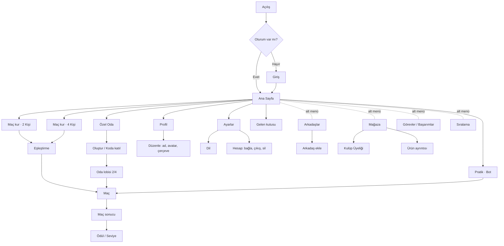
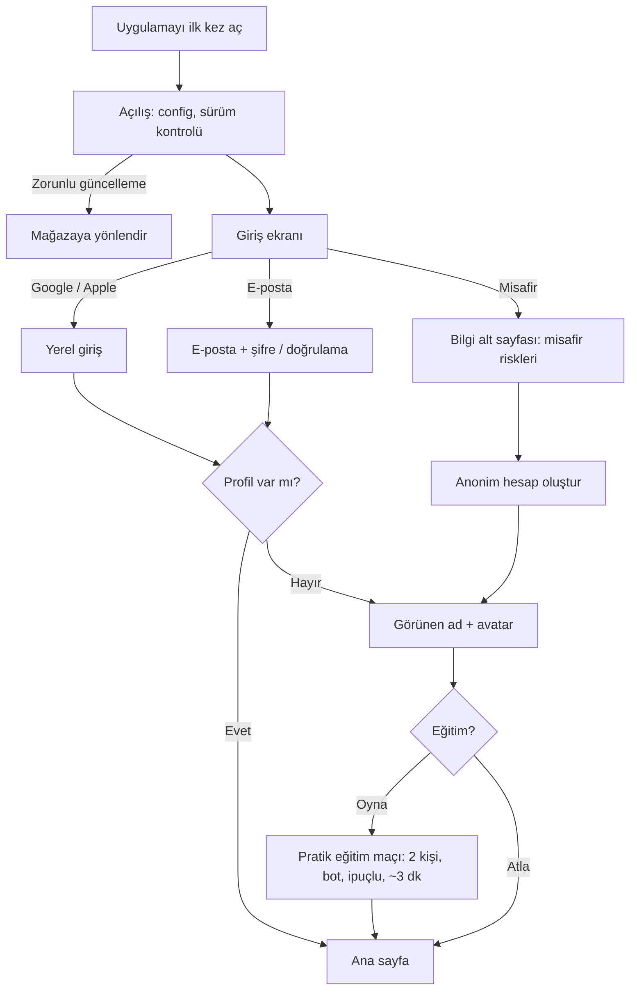
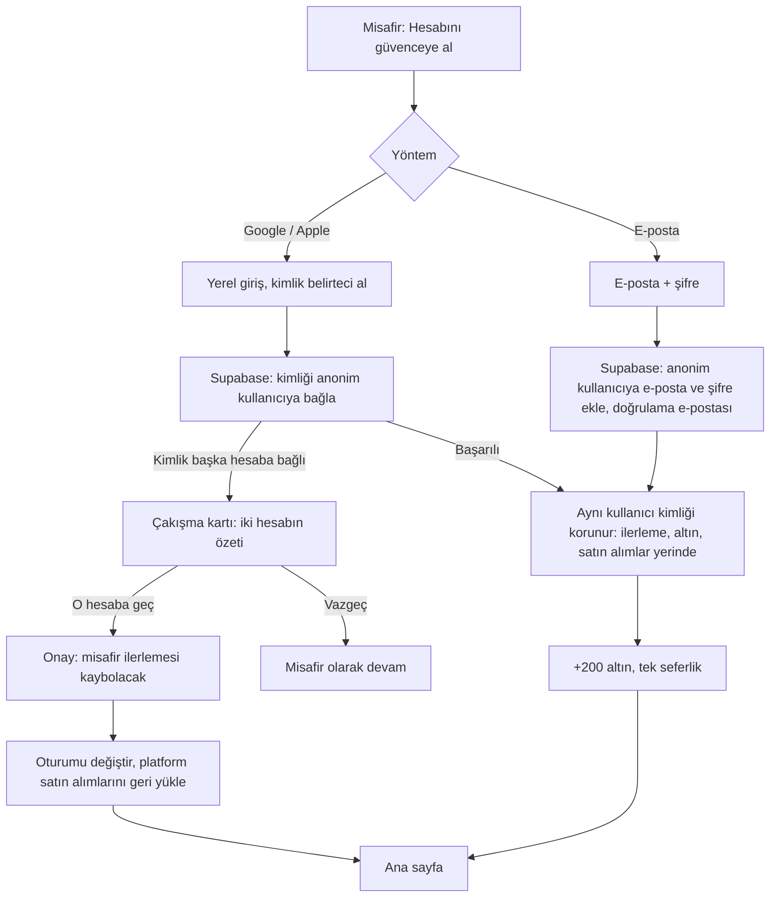
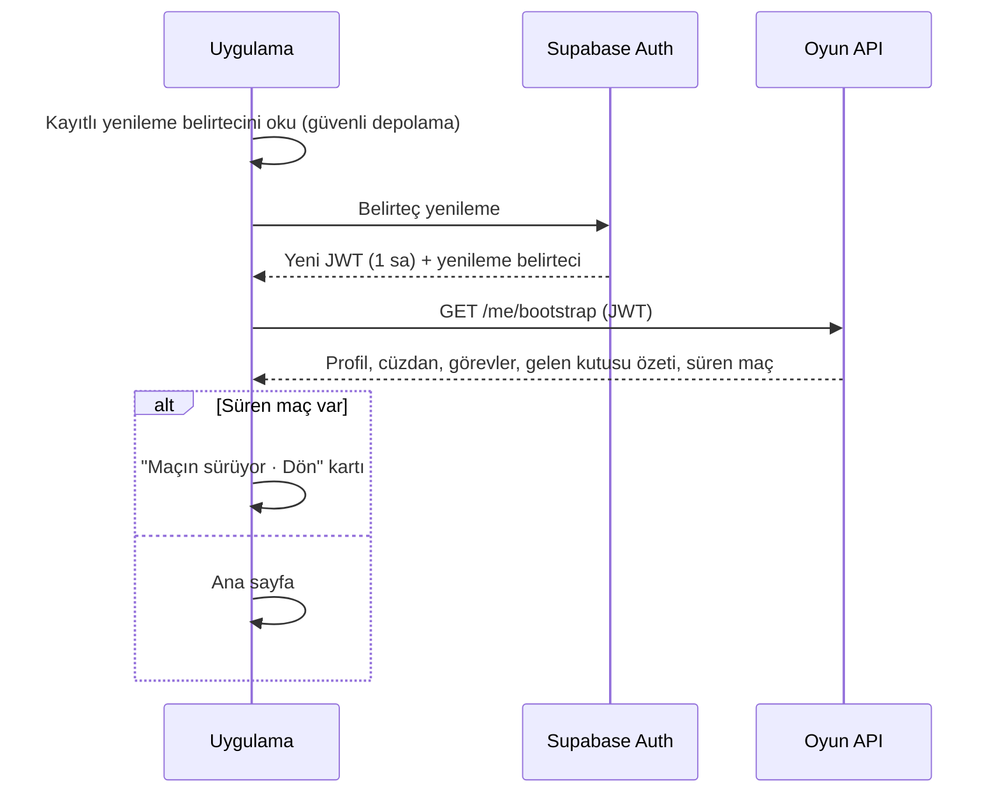
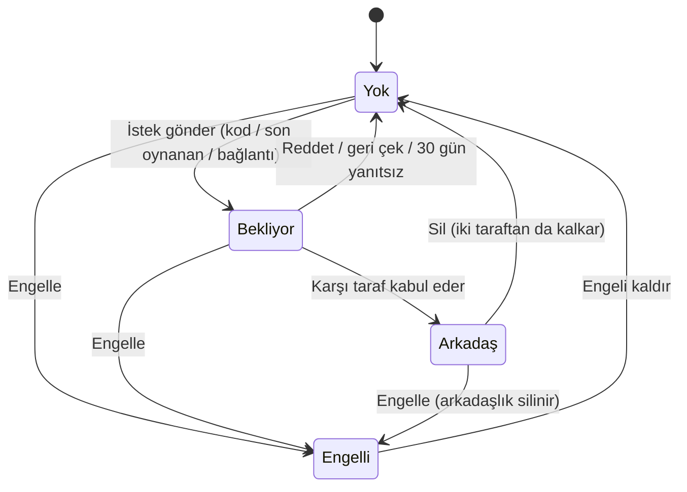
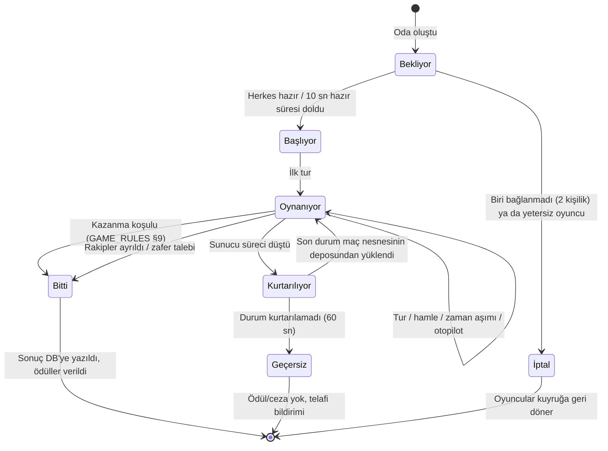
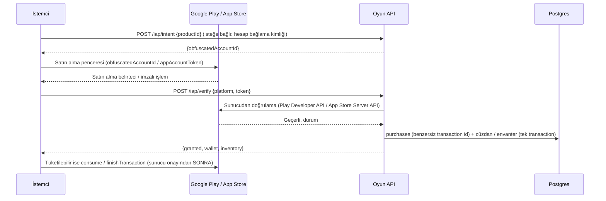
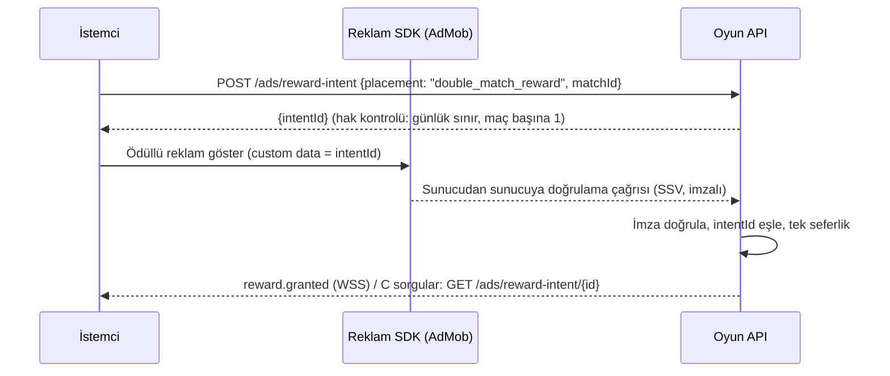
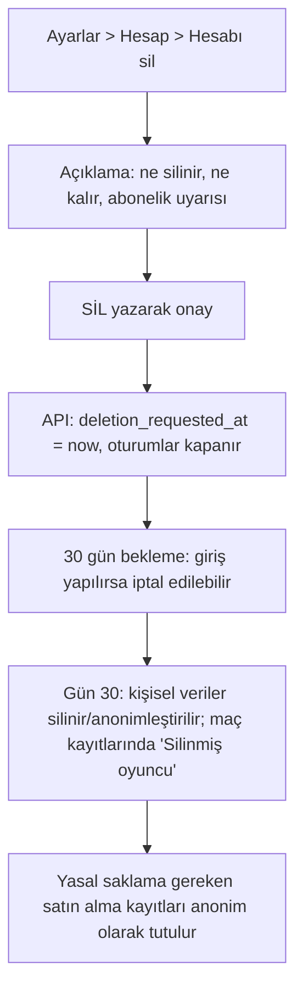

# USER_FLOWS — Kullanıcı Akışları ve Menü Hiyerarşisi

> **Durum:** Faz 1 taslağı (2026-11-16).
>
> **Faz 2 sonrası güncelleme (2026-11-17):**
> - Sunucu Cloudflare Workers + Durable Objects: Worker = ağ geçidi, Matchmaker ve MatchRoom = nesneler. Redis yok.
> - Davet ve çevrimiçi durumu Supabase Realtime ile.
> - 2 kişilikte renk seçimi eklendi (§5, §6).
> - Ayrıntı: [architecture/ONLINE_ARCHITECTURE.md](architecture/ONLINE_ARCHITECTURE.md).
>
> **İçerik:** Diyagramlar Mermaid ile çizildi. Ekran ayrıntıları [UI_SCREEN_SPECIFICATIONS.md](UI_SCREEN_SPECIFICATIONS.md) dosyasında, sunucu mesajları [NETWORK_PROTOCOL.md](NETWORK_PROTOCOL.md) dosyasında.

## 1. Menü hiyerarşisi (site haritası)



- **Derinlik:** Bütün ekranlara ana sayfadan en fazla **3 dokunuşla** ulaşılır.
- **Alt menü:** Ana Sayfa, Arkadaşlar, Mağaza, Görevler ve Sıralama'da görünür. Maç, eşleştirme, lobi ve satın alma ekranlarında gizlenir.

## 2. İlk açılış



- **Eğitim:** Etkileşimli ve kısa. Kurgulanmış zarlarla "6 at → çık → yıldız güvenli → ye → bitir" adımları gösterilir.
  - Bu kurgulanmış zarlar **yalnızca** çevrimdışı eğitimde kullanılır.
  - Çevrimiçi maçlarda zar daima sunucuda, rastgele üretilir.

## 3. Misafirden kalıcı hesaba geçiş ve çakışma



**İlkeler:**
- **Aynı kimlik korunur:** Yükseltme yeni hesap açmaz. Anonim kullanıcının kimliği (`auth.users.id`) aynı kalır; bütün tablolar bu kimliğe bağlı olduğu için hiçbir veri taşınmaz.
- **Satın alımlar platform hesabına bağlıdır:** Hesap değiştirilse de abonelik ve kalıcı ürünler **geri yükleme** ile yeni hesaba atanır (MONETIZATION §3.5).
  - Tüketilen altın paketleri geri yüklenmez. Bu yüzden çakışma kartında misafir hesabında harcanmamış satın alınmış altın varsa ayrıca uyarı gösterilir.
- **Birleştirme yok:** İki hesabın ilerlemesi birleştirilmez (K-54).
  - Gerekçe: hile riski (iki hesapta altın toplayıp birleştirme) ve karmaşık sonuçlar.
  - Alternatif (karar bekliyor): misafir hesaptaki **satın alınmış** kozmetik ve altın, destek ekibi ya da otomatik bir aktarım işlemiyle hedef hesaba taşınır.

## 4. Sonraki açılışlar ve oturum



- **Yenileme hatası:** Belirteç iptal edildiyse ya da hesap silindiyse oturum kapanır ve giriş ekranına dönülür. Misafir için bu, ilerlemenin kaybı demektir; nedeni açıkça anlatılır.

## 5. Hızlı maç

```mermaid
sequenceDiagram
  participant C as İstemci
  participant G as Cloudflare Worker (WSS ağ geçidi)
  participant MM as Matchmaker (Durable Object)
  participant R as MatchRoom (Durable Object)
  C->>G: queue.join {mode: "4p", ruleset: "classic_v1", tier}
  G->>MM: Kuyruğa ekle (nesnenin kendi deposunda)
  MM-->>C: queue.status {position, eta}
  MM->>MM: 4 oyuncu toplandı
  MM->>R: Oda oluştur (oyuncular, renkler; 2 kişilikte renk tercihleri K-55)
  R->>R: Altınlı seviyede giriş bedeli emanete (tek işlem, Supabase)
  R-->>C: match.found {matchId, seat, color, ticket}
  C->>R: match.ready
  R-->>C: match.snapshot (tam durum) + match.started
  loop Turlar
    R-->>C: turn.start {player, deadline}
    C->>R: action.roll {turnId, reqId}
    R-->>C: dice.rolled {value, legalMoves}
    C->>R: action.move {turnId, pawn, reqId}
    R-->>C: pawn.moved {path, captures, nextTurn}
  end
  R-->>C: match.ended {ranks, rewards}
```

- **Vazgeç:** `queue.leave`. Eşleşme bu sırada tamamlandıysa iptal öncelikli olur; oda diğerleri için yeniden kuyruğa döner.
- **Bot önerisi:** Eşleştiricinin süre eşiği aşılınca `queue.offer_bot` gönderilir; istemci kabul ederse oda botla tamamlanır (K-05).

## 6. Özel oda ve davet

```mermaid
sequenceDiagram
  participant A as Ayşe (sahip)
  participant S as Sunucu
  participant M as Mehmet
  A->>S: room.create {players: 4}  (2 kişilikte: {players: 2, color})
  S-->>A: room.state {code: "K7Q-4MZ", seats}
  A->>S: invite.send {to: Mehmet, roomId}
  alt Mehmet çevrimiçi (bağlı)
    S-->>M: invite.received (uygulama içi bildirim, 30 sn)
  else Çevrimdışı ya da arka planda
    S->>S: Push bildirimi (FCM / APNs) + gelen kutusu kaydı
  end
  M->>S: room.join {roomId | code}
  S-->>A: room.state (Mehmet koltukta; 2 kişilikte rengi otomatik karşı renk)
  A->>S: room.start
  S-->>A: match.found ... (§5'teki gibi)
  S-->>M: match.found ...
```

- **Davet kuralları:**
  - Yalnızca arkadaşlara davet gönderilir.
  - Engellenmiş kullanıcı davet gönderemez ve alamaz.
  - Davet 30 sn (uygulama içi) / 10 dk (push) geçerlidir.
  - Sınır: aynı kişiye 1 dk'da en fazla 1, toplamda dakikada 10 davet (SECURITY §9).
- **Kodla katılma:** Kod bilen herkes katılabilir (arkadaş olmak gerekmez). Oda sahibi oyuncuyu çıkarabilir.
- **2 kişilikte renk:**
  - Kurucu dört renkten birini seçer; katılan oyuncu karşı rengi alır (K-57).
  - Kurucu maç başlamadan rengini değiştirebilir; katılanın rengi de buna göre değişir.
  - Sunucu karşılıklı olmayan ya da çakışan seçimi reddeder (`COLOR_TAKEN` / `COLOR_INVALID`).
- **İletim:** Davet Supabase Realtime (`user:<id>` kanalı) ve gerekirse push ile iletilir; oda Cloudflare'deki MatchRoom'dadır.

## 7. Arkadaş ekleme, silme ve engelleme



- **Engellemenin etkisi** (tek yönlü, sessiz):
  - Engellenen kişi istek ve davet gönderemez.
  - Engelleyenin profilini, çevrimiçi durumunu ve odasını göremez.
  - Hızlı maçta mümkünse eşleşmezler (eşleştirici, kuyruktaki engelleme listelerine bakar).
  - Ortak maçta engellenenin hızlı mesajları gizlenir.
- **Şikâyet:** Oyuncu kartında ya da profilde "⋯ → Şikâyet et". Nedenler: uygunsuz ad, uygunsuz avatar / profil, kasıtlı oyun bozma, hile şüphesi, diğer.
  - Son maç kimliği otomatik eklenir.
  - Gönderen "Teşekkürler, inceleyeceğiz" yanıtını alır.
  - İsteğe bağlı olarak aynı ekranda "Bu oyuncuyu engelle" seçeneği sunulur.

## 8. Maç yaşam döngüsü (durum makinesi)



## 9. Bağlantı kopması ve geri dönüş

```mermaid
sequenceDiagram
  participant C as İstemci
  participant R as Maç odası
  Note over C: Ağ koptu (tünel, Wi-Fi → mobil veri)
  R->>R: Heartbeat yok (20 sn) → oyuncu "kopuk"; turları otopilot
  R-->>R: Diğerlerine player.status {disconnected}
  C->>C: Yeniden bağlanma döngüsü (0,5, 1, 2, 4, 8, 15 sn)
  C->>R: hello {resumeToken, lastSeq}
  alt Son sıradan itibaren olaylar hâlâ bellekte
    R-->>C: Eksik olaylar (seq > lastSeq)
  else
    R-->>C: match.snapshot (tam durum)
  end
  R-->>R: player.status {connected}; kontrol oyuncuya döner
```

- **Arka plana alma:**
  - iOS ve Android uygulamayı arka planda askıya alabilir; sunucu bunu kopukluk olarak görür.
  - Ön plana dönüşte istemci bağlantının ölü olduğunu varsayar ve hemen yeniden bağlanır; heartbeat süresini beklemez.

## 10. Satın alma (IAP)



- **Hatalar ve yarım kalanlar:** MONETIZATION §3.6 (bekleyen ödeme, iptal, uygulamanın kapanması, ağ hatası, iade).

## 11. Ödüllü reklam



- **SSV gelmezse:** Ödül verilmez. 3 sn içinde gelmezse istemci "Ödül doğrulanıyor" der. SSV geç gelirse ödül gelen kutusuna düşer.

## 12. Hesap silme



- **Mağaza kuralları:** Apple ve Google, uygulama içinden hesap silme yolunu zorunlu tutar. Google Play ayrıca web üzerinden silme talebi bağlantısı ister; bu bağlantı Faz 10'da hazırlanır.
