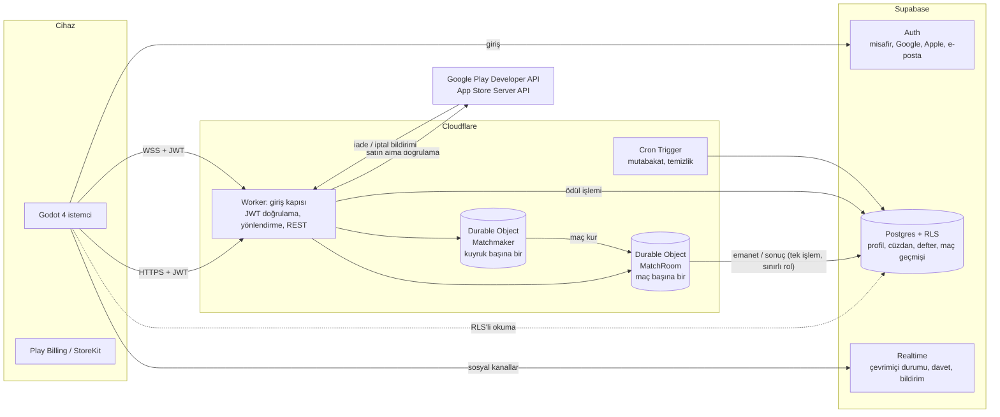
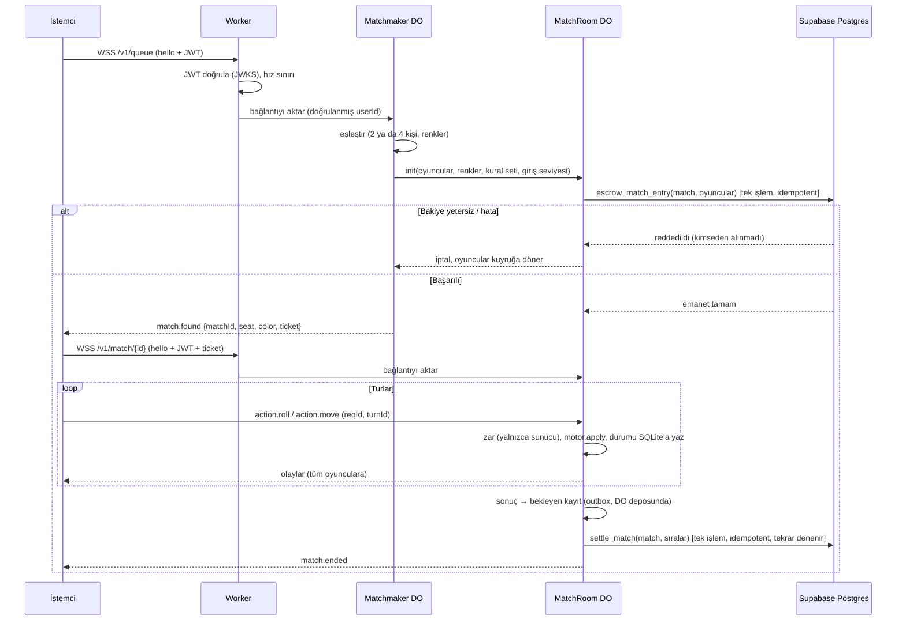

# ONLINE_ARCHITECTURE — Çevrimiçi Mimari (Genel Bakış)

> **Durum:** Faz 2 sonrası güncelleme (2026-11-17). **Kesinleşmiş mimari kararı** (K-36, DECISIONS §8).
>
> **Bu belge çevrimiçi sistemin giriş noktasıdır.** Ayrıntılar:
>
> | Konu | Belge |
> |---|---|
> | Cloudflare tarafı (Workers, Durable Objects, limitler, motorun uyumu) | [CLOUDFLARE_ARCHITECTURE.md](CLOUDFLARE_ARCHITECTURE.md) |
> | Supabase tarafı (Auth, Postgres, RLS, Realtime) | [SUPABASE_ARCHITECTURE.md](SUPABASE_ARCHITECTURE.md) |
> | Güvenlik | [SECURITY_ARCHITECTURE.md](SECURITY_ARCHITECTURE.md) |
> | Maliyet, ücretsiz plan limitleri, ölçek | [COST_AND_SCALING.md](COST_AND_SCALING.md) |
> | Altın ve Elmas ekonomisi | [../economy/GOLD_AND_DIAMOND_ECONOMY.md](../economy/GOLD_AND_DIAMOND_ECONOMY.md) |
> | Mesaj protokolü | [../NETWORK_PROTOCOL.md](../NETWORK_PROTOCOL.md) |
>
> **Bu aşamada hiçbir şey kurulmadı.** Hesap açılmadı, kod yazılmadı. Aşağıdaki her şey plandır; doğrulanmamış teknik ayrıntılar **(doğrulanacak)** olarak işaretli.

## 1. Değişikliğin özeti

| | Önceki plan (Faz 1–2) | Yeni başlangıç hedefi |
|---|---|---|
| Oyun sunucusu | Kiralık VPS / VDS üzerinde Node.js (`api`, `realtime`, `worker` süreçleri) | **Cloudflare Workers + Durable Objects** (yönetilen, sunucusuz) |
| Geçici durum, kuyruk, oda | Redis | **Durable Objects** (her maçın kendi nesnesi, kendi SQLite deposu) |
| Kimlik, kalıcı veri | Supabase | **Supabase** (değişmedi) |
| Sosyal gerçek zamanlılık | Supabase Realtime (Faz 2 kararı) | **Supabase Realtime** (değişmedi) |
| Kural motoru | TypeScript (`server/game-engine`) | **Aynı motor**, Workers çalışma ortamında (küçük uyarlamayla; §5) |
| Aylık sabit sunucu maliyeti | VPS kirası + yönetilen Redis | Geliştirmede **0 USD**; yayında küçük sabit ücret (§7) |

**Eski mimarinin durumu:** VPS / VDS + Node.js + Redis artık **başlangıç hedefi değil**. Kullanılamaz da sayılmıyor:
- **Node.js:** Motorun testleri, vektör üretimi ve araçlar Node'da çalışmaya devam eder. Cloudflare yetersiz kalırsa (ör. maliyet, bölge, limit) oyun sunucusu aynı motorla Node'a taşınabilir; bu yüzden motor **platformdan bağımsız** tutulur.
- **Redis:** Durable Objects bir işi (ör. çok bölgeli küresel kuyruk, çok yüksek hızda sıralama) güvenilir karşılayamazsa yeniden değerlendirilir. **Gerçek bir ihtiyaç ölçülmeden eklenmez.**

## 2. Bileşenler

| Bileşen | Sorumluluk | Otorite mi? |
|---|---|---|
| **Godot istemci** | Görüntü, giriş, animasyon, çevrimdışı pratik | **Hayır.** Hiçbir sonucu belirlemez. |
| **Worker (giriş kapısı)** | JWT doğrulama, hız sınırı, isteği doğru Durable Object'e yönlendirme, REST uçları (satın alma doğrulama, ödül talepleri) | Ekonomi isteklerini **doğrular**, kaydı Postgres yapar |
| **Matchmaker (DO)** | Hızlı maç kuyruğu (mod × giriş seviyesi), renk tercihi eşleştirme, bot önerisi | Eşleşmenin otoritesi |
| **MatchRoom (DO)** | Bir maçın **tek yetkili** kaynağı: zar, sıra, hamle doğrulama, kurallar, süreler, kopma / yeniden bağlanma, maç sonu | **Evet** (oyun durumu) |
| **Supabase Auth** | Kimlik ve JWT üretimi | Kimliğin otoritesi |
| **Supabase Postgres** | Kalıcı veri; **bakiyelerin ve defterin** tek kaynağı; atomik ekonomi işlevleri | **Evet** (para birimleri ve kalıcı veri) |
| **Supabase Realtime** | Arkadaş çevrimiçi durumu, davetler, sosyal bildirimler | **Hayır.** Maç durumu taşımaz; kural uygulamaz. |

**Bağlayıcı ilke:** Supabase Realtime **asla** yetkili oyun motorunun yerine geçmez. Maç durumu ve kurallar için tek kaynak MatchRoom'dur.

## 3. Bir maçın yaşam döngüsü

**Ayrıntılar:**
- **Özel oda (Faz 5'te uygulandı):** Oda kodu bir **PrivateRoom** nesnesine eşlenir (`idFromName("room:" + kod)`). Lobi (oyuncular, renk, hazır, oda sahibi) burada yürür. Oda sahibi başlatınca oda **yeni bir MatchRoom** (`mode: "private"`) oluşturur; maç hızlı maçla aynı nesne türünde, aynı motor, protokol ve istemci ekranıyla oynanır ve Faz 4'teki gibi kaydedilir. Maç bitince MatchRoom odaya haber verir, oda yeniden lobi olur. (İlk tasarımdaki "aynı nesne maça geçer" yerine bu yol seçildi: MatchRoom değişmeden yeniden kullanılır.)
- **Davet ve çevrimiçi durum (Faz 5'te uygulandı):** Tek bir **SocialHub** nesnesi (WebSocket): arkadaşların durumu (çevrimiçi / odada / maçta), içeriksiz "değişti" bildirimleri ve maç davetleri (yalnızca arkadaşa, engel yok, 120 sn). Oda dizini, oyuncunun hangi oda / maçta olduğu ve oda kodu deneme sınırı da burada. Arkadaşlık verisi Supabase'te (RLS, `auth.uid()` kullanan işlevler). Supabase Realtime kullanılmadı (K-64).
- **Zar:** Yalnızca MatchRoom üretir. İstemciden zar değeri **hiçbir koşulda kabul edilmez** (protokolde böyle bir alan yok).

## 4. Kesinleşen oyun kurallarının sunucudaki yeri

| Karar | Sunucuda nerede uygulanır |
|---|---|
| **Üst üste iki 6'dan sonraki atış yalnızca 1–5** (K-13) | MatchRoom'un zar kaynağı: `turn.sixes == 2` ise değer 1–5 arasında eşit olasılıkla üretilir. Motor da savunma olarak `sixes == 2` iken 6 değerini `INVALID_DICE` ile reddeder (GAME_RULES §6.2). |
| **2 kişilikte renk seçimi** (K-08) | Matchmaker (hızlı maç) ve MatchRoom (özel oda) renk kurallarını uygular: yalnızca karşılıklı çiftler (kırmızı–sarı, yeşil–mavi); çakışma `COLOR_TAKEN` ile reddedilir (NETWORK_PROTOCOL §4). |
| Diğer bütün kurallar | `server/game-engine` (değişmeden) |

## 5. TypeScript motorunun yeri

- **Motor değişmeden kullanılır.** MatchRoom yalnızca motoru çağıran ince bir kabuktur: bağlantılar, süreler, kalıcı yazma, yayın.
- **Gereken uyarlamalar küçük** (ölçüldü, CLOUDFLARE_ARCHITECTURE §5):
  - Tek Node'a özgü bağımlılık: `dice.ts` içindeki `node:crypto` `randomInt`. Web Crypto tabanlı, platformdan bağımsız bir zar kaynağına geçilecek.
  - Üçüncü atış kuralı (K-13) motorda ve GDScript eşinde uygulanacak; vektörler yeniden üretilecek.
- **Faz 3.1'de yapıldı** (2026-11-17): Web Crypto zar kaynağı ve 1–5 kuralı iki motora ve vektörlere işlendi. Motorun Node'a özgü hiçbir içe aktarması kalmadı.

## 6. Kurtarma (özet)

| Olay | Davranış |
|---|---|
| İstemci bağlantısı koptu | Maç sürer; oyuncunun turları otopilotla oynanır (K-23). Geri dönüşte tam durum gönderilir. |
| MatchRoom yeniden başladı (kod güncellemesi, altyapı) | Durum her eylemden sonra nesnenin kendi SQLite deposunda (K-60). Nesne yeniden yüklenir, zamanlayıcı (alarm) kalıcıdır, istemciler yeniden bağlanır. |
| Supabase geçici erişilemez | Süren maçlar etkilenmez. Yeni maç girişi (emanet) yapılamaz. Maç sonu kaydı MatchRoom deposunda bekler ve tekrar denenir (idempotent). |
| Durum kurtarılamaz (çok düşük olasılık) | Maç **geçersiz**: emanetler iade edilir, ödül ve ceza yok (GAME_RULES §11.8). Mutabakat işi, sonuçlanmamış emanetleri belli bir süre sonra otomatik iade eder. |

Ayrıntı: CLOUDFLARE_ARCHITECTURE §6, SECURITY_ARCHITECTURE §7.

## 7. Maliyet (özet)

- **Ücretsiz planlar:** Geliştirme ve küçük kapalı testler için yeterli.
- **Yayın için yetersiz.** En dar limit, Durable Objects'in ücretsiz planda günde 100.000 satır yazma sınırı. Mevcut tasarım ve tahmini maç temposuyla bu, gün boyunca ortalama ~1 eşzamanlı maça yetiyor. Limit aşılınca işlemler **hata verir**, yani maçlar yarıda kalır.
- **Yayında önerilen en düşük yapı:** Cloudflare Workers Paid (aylık 5 USD) ve Supabase Pro (aylık 25 USD; yedekleme ve duraklatılmama için).
- **Ayrıntı ve senaryolar:** 100 / 500 / 1.000 eşzamanlı oyuncu için COST_AND_SCALING.md. Değerler **tahmin**; Faz 5'te ölçülecek.
